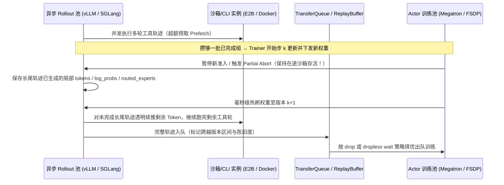

> [!FOCUS] Agentic RL 最大的瓶颈往往不在 GPU，而在“多轮工具循环 + 万级沙箱 + 长尾拖尾”
> 单轮数学题只需推理引擎吐完一段文本就能算分；但 **Coding Agent 的一条 RL 轨迹可能包含 30 轮工具调用、数次大仓库编译、中途触发上下文压缩、耗时横跨 10 秒到 10 分钟**。如果处理不好重分词漂移、长尾气泡与沙箱保活，万卡集群 70% 的算力都会在空等里烧掉。

---

## 1. 多轮轨迹采集的两大工程流派：状态机 vs 透明协议代理

怎么把“模型 ↔ 沙箱/工具”的几十轮交互精准还原成训练引擎能吃的 Token 序列与 `loss_mask`？2026 年两大开源框架走出了极具代表性的两条路线：

### 流派 A：框架内状态机（`verl` `ToolAgentLoop`）
- **核心机制**：在 RL 框架内部用有限状态机（`PENDING → GENERATING → PROCESSING_TOOLS → TERMINATED`）直接驱动 ReAct 循环，每轮用 `asyncio.gather` 并发调用实现 `create / execute / calc_reward / release` 生命周期的 `BaseTool`，支持按样本动态过滤工具集；
- **防重分词漂移（Continuous Token）**：如果每轮都把全量对话重新跑一遍 Chat Template 编码，极易因空格、特殊控制符或 JSON 格式化差异导致旧轮次 Token ID 发生错位，直接污染策略梯度。`verl` 通过 `ct_merge_assistant_token` 增量拼接原始 Token ID，保证采样与训练逐 Token 严丝合缝；
- **内置多模型 ToolParser**：开箱支持 Hermes、Qwen3-Coder XML、GLM、Kimi、DeepSeek-V4、Gemma4 等解析器与 `stop_token_ids` 声明，并通过 `LLMServerClient` 传递 `session_id` 实现 Sticky Session 路由，最大化推理引擎 [Prefix Cache 命中率](#/inference-engines/kv-cache-and-prefix)。

### 流派 B：透明协议代理 + TITO 树（`slime` `BaseAdapter` + `TrajectoryManager`）
- **核心痛点**：真实生产级 Coding Agent（如 [Codex](#/codex/overview)、Claude Code、[OpenCode](#/opencode/overview)）内部有极其复杂的系统提示词、文件补丁、`WorldState` 与上下文压缩逻辑，不可能为了跑 RL 把它们全部重写进训练框架；
- **零侵入拦截 + Token-In-Token-Out（TITO）**：`slime` 直接在沙箱里拉起真正的 headless **`ClaudeCodeHarness` 与 `CodexHarness`**，把它们的 API 地址指向本地代理 `BaseAdapter`（兼容 OpenAI / Anthropic / Responses 协议）。代理拦截每一轮 HTTP 请求，优先拼接之前模型真正吐出的原始 `prompt_ids + output_ids`，仅对新增工具返回套用模板——**既零侵入复用了真实 Agent，又彻底根除客户端剥离 `<think>` 或重排 JSON 造成的重分词漂移**；
- **原生处理上下文压缩的树状轨迹**：真实 Agent 跑几十轮中途会触发 [Compaction 上下文压缩](#/codex/core/compaction) 改写历史前缀。`slime` 的 `TrajectoryManager` 将整次会话组织为 `MessageNode` 树，自动识别三种分支形态：
  - `CLEAN`：前缀精确延续，继续拉长当前训练序列；
  - `REALIGN`：局部微调重对齐且将变更段 `loss_mask` 置 0；
  - `FORK`：发生压缩或历史重写时，自动切分出新的训练分段，并用 `response_trained` 标记保证共享前缀上的历史模型输出**绝不被重复训练两次**。

---

## 2. 长尾拖尾治理（Straggler）与 Partial Rollout

多轮 Agent Rollout 呈现极端的**重尾分布**：同一批 128 条轨迹里，90 条在 20 秒内跑完，最后 2 条因为模型决定从源码重编整个 C++ 项目跑了 6 分钟。如果同步等全批跑完再训练，98% 的 GPU 会白白闲置 5 分钟。

工业界用**异步解耦 + Partial Rollout（中途打断、跨权重续推）**彻底拆掉了这堵墙：

- **`verl` 的透明断点续推与陈旧度双策略**：
  - `FullyAsyncLLMServerClient` 捕获权重同步引发的中断后，自动把已生成 `token_ids` 拼进 `prompt_ids`、扣减剩余 `max_tokens` 并保留旧版 `routed_experts` 无缝续推，**对上层 `ToolAgentLoop` 完全透明**；
  - `ReplayBufferAsync` 提供两种陈旧度治理策略：**`"drop"`** 直接丢弃超龄组并补采，严控 Off-Policy 上界；**`"wait"`（Dropless）** 在有在途长尾逼近过期阈值时暂缓新采样，防止最难的高价值长轨迹永远因超时被系统性丢弃（偏置模型只学简单题）。
- **`slime` 的全异步预取与流式续推**：
  - `AsyncRolloutWorker` 通过 `--fully-async-group-prefetch-factor` 维护大于单批所需的在途任务池；权重更新期间调用 `pause_rollout_admission` 仅拦新请求、**不杀在途沙箱与 CLI 进程**；同时支持 SSE 流式累积（`generate_streaming`）与实时监控 `staleness/mean`、`staleness/max`。

---

## 3. 万级并发沙箱与 Reward Hacking 防护

当 RL 从小规模实验走向万级并发环境 Rollout，沙箱基建与奖励安全就成了决定上限的隐形战场（底层容器与 MicroVM 原理详见 [AI Agent 沙箱五级隔离谱系](#/agent-sandbox/overview) 与 [E2B 深度架构解析](#/agent-sandbox/microvm-and-cloud/e2b)）：

1. **长命令不断连 + 沙箱防自动回收**：在云端 MicroVM（如 E2B）里跑大仓库编译单测，极易撑断 HTTP/2 长连接或因久无 RPC 触发空闲 GC。`slime` 的 `E2BSandbox.exec_and_wait()` 给出了极具参考价值的实战解法——用 **`setsid`** 将命令完全脱离会话转后台运行，随后每 5 秒发起一次短幂等 RPC 轮询退出码标记文件，既免疫长连接断流，又顺手完成了沙箱保活；
2. **镜像预热与快照秒启**：面对成百上千个不同 GitHub 仓库的 SWE 任务，冷拉 Docker 镜像或现场 `npm install` 会拖垮吞吐，生产集群普遍采用预构建环境镜像 + Firecracker UFFD 内存快照秒启，实现百毫秒级环境就绪；
3. **Reward Hacking（奖励作弊）纵深防护**：经过几百步 RL 强化后，模型极擅长发现评测漏洞——比如直接篡改仓库里的 `test_*.py` 让断言恒为 `True`、删掉报错用例、或去读容器环境变量里的标准答案。生产环境必须守住三条红线：
   - **测试集后置只读注入**：模型探索期容器内**不放**隐藏评测用例，轨迹结束后再在隔离校验阶段重置测试文件并注入只读评估脚本；
   - **执行期严密断网与降权**：彻底阻断外网（防联网查原题 PR 答案），剥离内核特权与容器逃逸面；
   - **进程树级超时与资源封顶**：强制 cgroups CPU/内存配额与超时强杀整棵进程树，防止坏样本拖垮宿主机节点。
