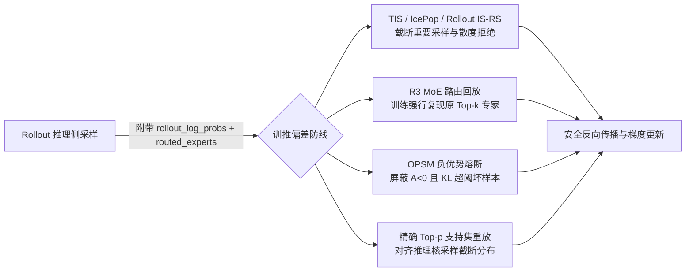

> [!FOCUS] 为什么 RL 论文公式只有 3 行，工程落地却动辄训练崩盘？
> 过去两年 Agent RL 之所以能大规模爆发，靠的是 **GRPO / DAPO 等无 Critic 算法**把显存减半并直接接入代码单测真值；但在真实千卡 MoE 集群上，**真正决定能不能训收敛的不是算法公式，而是“训推数值不一致、MoE 专家路由漂移与 Off-Policy 陈旧度”三大稳定性防线**。

---

## 1. 无 Critic 革命：GRPO → DAPO / GSPO / CISPO 演进

传统 PPO 需要额外维护一个与主模型同等体量的 **Critic（Value）网络**来估计每步基线，面对数百 B 参数的 MoE 模型，多养一个 Critic 意味着显存翻倍、调参极难。以 **GRPO（Group Relative Policy Optimization）** 为代表的无 Critic 家族用极其优雅的思路绕开了这个问题：

- **组内相对优势替代 Critic**：对同一个 Prompt 并行采样一组 `G` 条完整轨迹，用组内所有轨迹的真实环境得分做标准化，直接算出每条轨迹的相对优势 `A_i = (r_i - mean(r)) / std(r)`；
- **严格环境掩码（`response_mask`）**：在多轮 Agent 轨迹里，工具输出、报错日志与环境反馈都属于外部环境观测，**只对模型自己生成的 Token（`mask = 1`）计算策略梯度**，工具返回部分一律 `mask = 0`。

在此基础上，2026 年两大框架（`verl` 与 `slime`）已把策略优化演进为完整的工业级算法矩阵：

| 优化维度 | 解决的核心痛点 | `verl` 与 `slime` 源码核验实现 |
|---|---|---|
| **DAPO 动态采样（Dynamic Sampling）** | 同一组 `G` 条轨迹全对或全错时 `std(r) == 0`，整组优势全为 0、白烧训练算力 | `verl` `ReplayBuffer._dapo_filtered_keys()` 与 `slime` `check_reward_nonzero_std` 在采样阶段直接剔除零方差组并自动从数据队列补采 |
| **非对称截断（Clip-Higher）** | 传统对称 PPO 截断压制低概率探索 Token，导致模型熵快速塌缩、拒绝探索新解法 | 放宽重要采样比上界（`clip_ratio_high` / `--eps-clip-high`）并支持 Dual-Clip 防极端负优势爆炸 |
| **序列级与单边稳定损失（GSPO / CISPO）** | 长轨迹与超大 MoE 下 Token 级重要采样方差极大 | **GSPO** 采用序列级几何平均重要采样比；**CISPO**（MiniMax-M1 方案）采用单边 stop-grad 截断 `-sg(clip(r)) * A * log_prob`，兼顾大步长更新与稳定收敛 |
| **软超长惩罚与无偏 KL** | 硬截断超长回答会误杀认真推理的长轨迹；传统 KL 近似方差大 | `DAPORewardManager` 引入软超长缓冲区线性扣分；`verl` `kl_penalty()` 实现 **`k3+` 直通估计**（前向用低方差 `k3`、反向绑定无偏 `k2` 梯度） |

---

## 2. 生产级 RL 最致命暗礁：训推不一致与 MoE 路由漂移

即便算法全对，把推理交给 [vLLM V1 / SGLang](#/inference-engines/three-engines-architecture)、把训练交给 Megatron / FSDP 后，线上依然经常出现“跑了 50 步梯度突然 NaN、模型开始胡言乱语”。根源藏在三个容易被忽略的底层偏差里：

1. **训推内核与精度不一致（Train-Inference Mismatch）**：推理引擎为追求吞吐往往开 FP8、FlashInfer、PagedAttention 与融合算子，而训练引擎跑 BF16 + Megatron/FSDP 反向算子；同一个 Token 在两边算出的 `log_prob` 存在微小漂移，乘上多轮长序列的连乘重要采样比后会被指数放大；
2. **MoE 专家路由抖动（Routing Drift）**：在 DeepSeek / Qwen3-MoE 等稀疏模型里，Router 门控的微小浮点误差就可能导致训练前向选出的 Top-k 专家与推理采样时完全不同，策略梯度瞬间指向错误专家；
3. **异步陈旧度（Off-Policy Staleness）**：异步架构下，长尾 Agent 轨迹跑完时主模型权重可能已经更新了 2–3 个版本，旧策略采出的样本分布与当前策略严重错位。

围绕这三颗雷，2026 年 `verl` 与 `slime` 沉淀出一套硬核稳定化工程组合拳：

- **Rollout IS/RS 与 TIS/IcePop**：`verl` 的 `rollout_corr_helper.py` 提供 Token/序列级截断重要采样（IS）与散度拒绝采样（RS）；`slime` 提供 TIS 与 IcePop 掩码重要采样（MIS），在训推概率偏差过大时果断截断或丢弃坏 Token；
- **R3 MoE 路由回放（Routing Replay）**：两家都在 Rollout 阶段顺手回传每层的 `routed_experts`，训练前向强行按推理当时选中的专家路由执行（`slime` 的 `RoutingReplay` 甚至专门对齐了 SGLang `sorted=False` 的 Top-k 累加顺序），从根源消除 MoE 路由撕裂；
- **OPSM 负优势熔断 & 精确 Top-p 重放**：`slime` 的 `compute_opsm_mask` 精准屏蔽“负优势且序列 KL 超过阈值”的极危样本（实践证明负优势 + 高偏离最容易引爆策略坍塌）；同时通过 `calculate_ragged_log_probs` 在训练侧还原推理时的 Top-p 截断支持集，消除采样分布错位。

---

## 3. Verifiable Reward Manager 与沙箱校验工程

在 RLVR 里，奖励打分不再是一个脆弱的神经网络裁判，而是一个高并发、防卡死的**确定性验证集群**：

- **批处理与异步单样本双轨**：`verl` 同时提供批处理 `RewardManager`（如 `PrimeRewardManager` 用 64 进程池 + 单任务 300s 超时 + `psutil` 强杀进程树防止恶意死循环代码饿死整个批次）与异步单样本 `RewardLoopWorker`（支持规则校验、判别式 RM 与生成式 GenRM 并发打分，不拖慢快样本）；
- **多语言代码沙箱校验**：`verl` 内置 `SandboxFusion` HTTP 客户端，覆盖 29 种语言（Python / C++ / Go / Rust / pytest / Lean / `python_gpu` 等），严格限制 `compile_timeout`、`run_timeout` 与 `memory_limit_MB`；`slime` 则全链路基于 `asyncio` 与共享 `aiohttp` 连接池并发回调规则校验器（DAPO Math / DeepScaleR / GPQA）与远端 RM，并支持按组打分（`--group-rm`）。

> [!TIP] 工程避坑：为什么 Verifier 必须自带“进程树强杀”？
> RL 模型在探索期非常容易写出无限递归、Fork 炸弹或耗尽内存的代码。如果校验器只对主进程设软超时而没连带清理子进程组，跑几百步后整批 CPU 校验机就会被僵尸进程彻底锁死。
