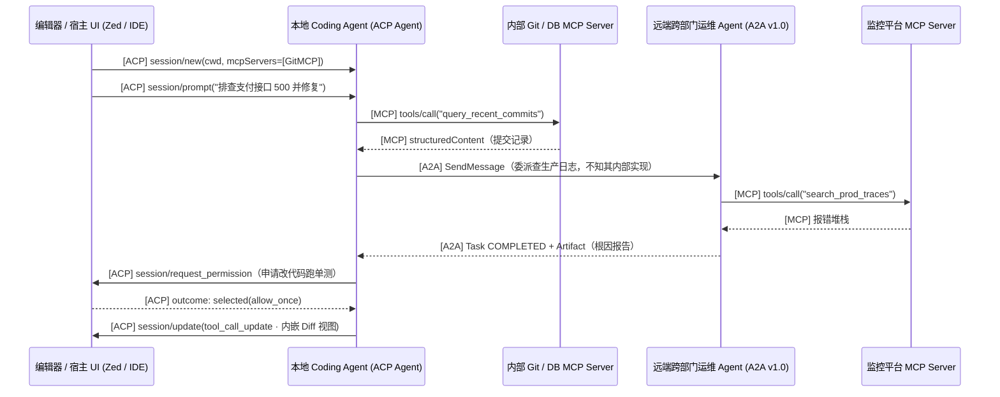

> [!FOCUS] 为什么 Agent 生态同时需要 MCP、ACP 和 A2A？
> 把三种协议混为一谈，是当前 AI 工程里最常见的架构误区。实际上它们解决的是**完全正交的三个边界**：**MCP** 负责 Agent **向下**接工具与数据源，**ACP** 负责 IDE/宿主 **面向人机交互**驱动 Coding Agent，**A2A** 负责独立 Agent **横向**跨组织委派长时任务——三者不是竞争替代，而是天然组合的互联网式分层协议栈。

---

## 1. 三协议核心边界全景对照（2026-11 一手规范核验）

本专题全部字段、版本与报文均核验自三大官方规范仓库最新主线：
- **MCP**：`modelcontextprotocol/modelcontextprotocol @ b0be8f0f`（`2026-11-23`，最新稳定版 **`2026-07-28`**）
- **ACP**：`agentclientprotocol/agent-client-protocol @ 840484ff`（`2026-11-24`，稳定版 **`v1` / `v1.35.0`**，预览版 **`v2-beta.4`**）
- **A2A**：`a2aproject/A2A @ 5f931b8a`（`2026-11-18`，Linux Foundation AAIF 旗下稳定版 **`v1.0.1`**）

| 对比维度 | **MCP**（Model Context Protocol） | **ACP**（Agent Client Protocol） | **A2A**（Agent2Agent Protocol） |
|---|---|---|---|
| **连接方向与拓扑** | **纵向（Vertical）**：Agent / Host ↔ Tool / Data Source / Prompt | **人机宿主层（Client ↔ Agent）**：Editor / IDE / UI ↔ Coding Agent | **横向（Horizontal）**：Agent ↔ 独立远端 Agent（跨组织/跨框架） |
| **类比对象** | AI 世界的 **USB-C 外设总线** | AI Coding Agent 领域的 **LSP** | 跨组织分布式系统的 **异步 RPC / 委派总线** |
| **核心抽象原语** | `Tools`（函数调用）、`Resources`（只读数据）、`Prompts`、`Elicitation` | `Session` + 交互 `Prompt Turn` + 19 种富流式 `session/update`（Diff/Plan/审批） | `AgentCard`（发现）+ 终态不可变 `Task` 状态机 + `Message`/`Part` + `Artifact` |
| **透明度与信任模型** | **契约透明、受控隔离**：显式 JSON Schema 入/出参；Server 不可读全局对话，也不窥视其他 Server | **高信任、强协同**：Client 实时渲染思考链、Diff 与工具状态并介入 HITL 审批 | **不透明执行（Opaque Execution）**：零信任跨边界，不暴露内部记忆、Prompt、推理或私有工具 |
| **协议绑定与传输** | JSON-RPC 2.0（`stdio` + 二代纯 POST **Streamable HTTP**） | JSON-RPC 2.0（标准 `stdio` NDJSON；HTTP/2 Streamable HTTP + WS 处于 RFD） | `a2a.proto` 唯一规范源：**JSON-RPC 2.0**、**gRPC**、**HTTP+JSON REST** 三绑定 + SSE / Webhook |
| **发现与协商机制** | `2026-07-28` 无状态 `server/discover` + 每请求 `_meta` 自带版本/能力 | `initialize` 协商整型 `protocolVersion` 与双向 `capabilities` | 预连接发现 `GET /.well-known/agent-card.json`（支持 JWS 签名）+ `A2A-Version` 头 |
| **长时任务与恢复** | 核心以单次调用为主；长时异步任务已移至官方扩展 `io.modelcontextprotocol/tasks` | 会话级持久化（`session/load` / `session/resume` 重放）与实时取消 `session/cancel` | **Async-First**：原生 `INPUT_REQUIRED` / `AUTH_REQUIRED` 中断态、Webhook 推送与 `SubscribeToTask` 断线重订 |

> [!WARNING] 关键概念消歧：此 ACP 非彼 ACP
> 开源社区曾出现两个同名缩写 **ACP**：
> 1. **Agent Client Protocol**（Zed 等编辑器生态主导，本专题主角）：用于 **IDE ↔ Coding Agent**，已被 [OpenCode](#/opencode/server-and-ecosystem) 与 [DeepSeek Harness](#/deepseek-harness/overview) 原生集成；
> 2. **Agent Communication Protocol**（IBM BeeAI 早期提出）：用于 Agent 间通信，**已于 2025 年 8 月归档并并入 Linux Foundation 下的 A2A**。

---

## 2. 真实生产环境里三者如何协同工作？

把三层协议串到一次真实的“开发者在 IDE 里排查线上故障”场景中，就能一眼看清它们各自的不可替代性：

- **ACP 管好“人和 Coding Agent 的工作台体验”**：让任意编辑器只需对接一套协议，就能换插不同的 Coding Agent，获得原生 Diff 渲染、计划进度条、工作区注入和 HITL 审批弹窗；
- **MCP 管好“Agent 和确定性工具/数据的标准化插口”**：无论是本地 Coding Agent 还是远端运维 Agent，内部统一通过 MCP 连接数据库、Git、监控与知识库；
- **A2A 管好“跨组织、跨团队的自主协作边界”**：运维团队不需要把生产监控 API 密钥和内部排障 Prompt 交给你，只需发布一张 `AgentCard`，按任务单接收委派、交付脱敏后的 `Artifact` 诊断报告。

> [!NOTE] 本专题阅读导览
> - 深入 **MCP `2026-07-28` 无状态架构大重构、二代 Streamable HTTP 与 MRTR 反问机制** → 下一篇 [02 · MCP 架构演进：无状态与 MRTR](#/agent-protocols/mcp-architecture)；
> - 深入 **MCP Schema 膨胀治理、OAuth 2.1（CIMD 替代 DCR）与六大安全防线** → [03 · MCP 生产治理、OAuth 2.1 与安全防线](#/agent-protocols/mcp-governance-and-security)；
> - 深入 **ACP v1/v2、A2A v1.0 协议细节、最小 Wire 报文与五大开源 Agent 落地映射** → [04 · ACP 与 A2A 深度解析及五大 Agent 映射](#/agent-protocols/acp-and-a2a)。
