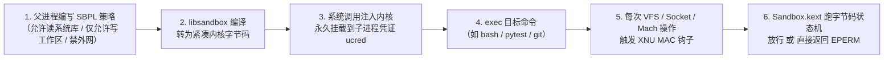

> [!NOTE] 本页聚焦
> 深入拆解 **macOS Seatbelt** 的内核工作机制：策略怎么进内核、每次文件/网络操作怎么被拦截、为什么孙进程逃不出去，以及它在 Coding Agent 中的实战边界。

## 1. 底层内核底座：XNU TrustedBSD MAC 框架

macOS 的底层内核 XNU 内置了源自 FreeBSD 的 **MAC（Mandatory Access Control，强制访问控制）框架**。和传统的 Unix 文件权限（DAC，看 `rwx` 和属主）不同，MAC 是**凌驾于普通用户权限之上的内核级强制策略检查**——即使进程拥有某个文件的读写权限，只要 MAC 策略说“不许写”，内核也会直接拒绝。

苹果基于 MAC 框架实现了一个核心内核扩展 **`Sandbox.kext`**（俗称 **Seatbelt**）。我们平时听到的 macOS App Sandbox、Safari 渲染进程沙箱、以及 Codex / Claude Code 在 macOS 上调用的 `sandbox-exec`，底层全都是这套机制。

---

## 2. 从声明式策略到内核拦截的完整链路

### 关键底层细节
1. **策略如何进入内核？**
   - 策略文本使用类似 Scheme 的声明式语言 **SBPL（Sandbox Profile Language）** 编写，支持按路径前缀、正则、子路径（`subpath`）和网络端口精确授权。
   - 用户态 `libsandbox` 将 SBPL 编译为极小的**二进制策略字节码**，通过专用系统调用注入内核，直接挂在当前进程的 **`ucred`（内核凭证结构）** 上。
2. **运行时零用户态切换的极速拦截**：
   - 当沙箱内的命令调用 `open()`、`unlink()`、`connect()` 或查询 Mach 服务时，请求进入内核的 VFS、网络协议栈或 Mach IPC 子系统；
   - 这些子系统在真正执行操作前，都会调用预先注册好的 **MAC Policy Hooks**；
   - `Sandbox.kext` 直接在内核态执行策略字节码匹配，命中拒绝规则立刻返回 `EPERM`（Operation not permitted），全程不经过用户态代理，性能开销极低。
3. **不可撤销的遗传特性**：
   - `ucred` 在 `fork()` / `exec()` 时自动被所有子进程、孙进程继承；
   - 沙箱内的进程**永远无法卸载或放宽自己的策略**（哪怕想通过 `sandbox_init` 重新初始化，内核也只允许“更严格”或直接拒绝）。

---

## 3. Coding Agent 实战中的常见设计与注意点

- **“只写工作区 + 仅连本地代理”模式**：
  - 典型 Coding Agent 的策略会默认 `(deny default)`，然后显式放行：系统共享库只读、当前项目工作区与 `/tmp` 可读写、屏蔽 `~/.ssh` / `~/.aws` 等敏感目录；
  - 网络侧可以彻底禁止直连公网，或者只放行连接到 `127.0.0.1:<proxy-port>`，再由宿主机代理按域名白名单转发（Claude Code 的网络沙箱就常用这套组合）。
- **关于 `sandbox-exec` 被标为 Deprecated 的真相**：
  - 苹果把命令行工具 `sandbox-exec` 标为废弃（希望第三方 App 上架用官方 Entitlements），但**底层的 MAC 框架与 `Sandbox.kext` 仍是整个 macOS 安全的命脉**，短期内不可能移除；这也是 Codex 和 Claude Code 依然广泛依赖它的原因。
- **符号链接与路径规范化坑**：
  - Seatbelt 按真实解析后的路径做匹配（例如 macOS 上 `/tmp` 实际是 `/private/tmp` 的软链、`/var` 是 `/private/var` 的软链），写策略时必须放行规范化后的真实路径，否则命令会莫名其妙报 `EPERM`。
