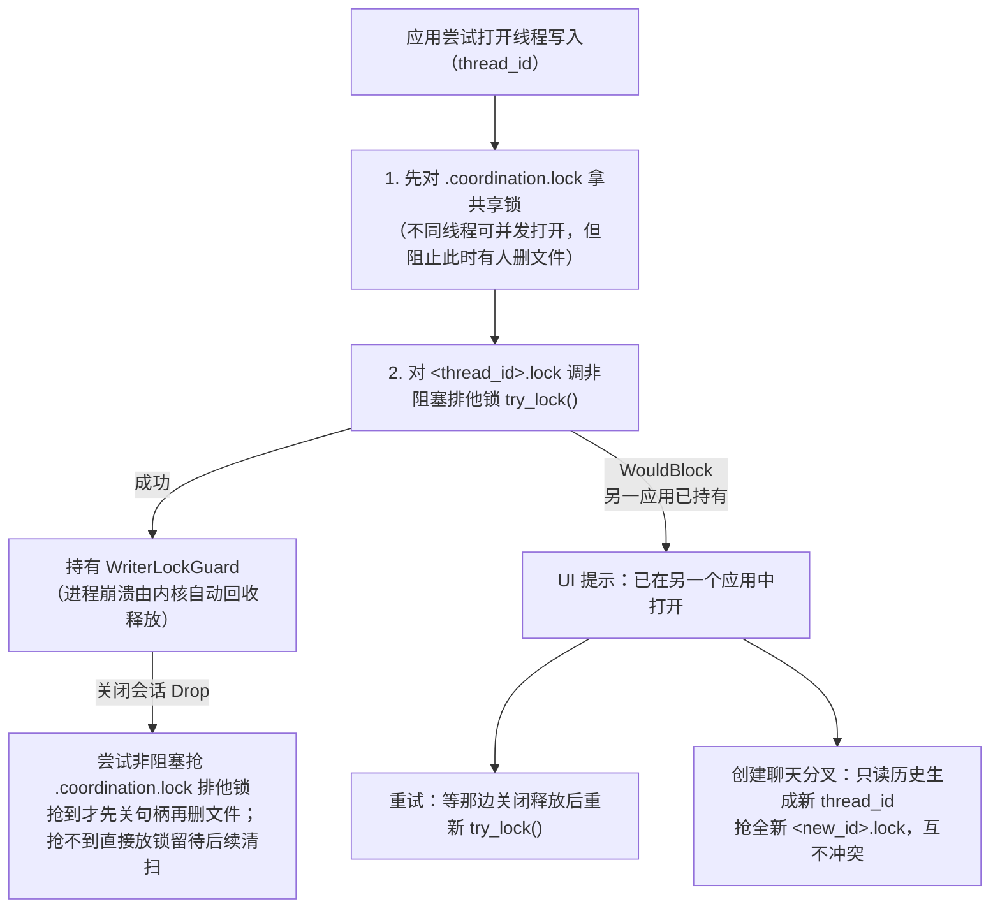
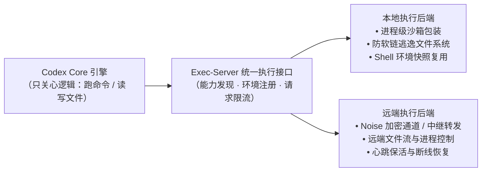

> [!FOCUS] 架构亮点
> 很多开源 Coding Agent 只有一层“CLI 进程”；Codex 却专门拆出了 **`app-server`（控制面服务协议）** 与 **`exec-server`（执行面服务抽象）** 两层独立边界——这是它能同时支撑终端、IDE、桌面端和远端执行的根本原因。

## 1. 为什么要有 `app-server`？

如果 IDE 插件、桌面 App 和第三方宿主（如 OpenClaw）各自去解析 CLI 的标准输出文本，很快就会陷入格式脆弱、断线丢状态、审批卡死的泥潭。

Codex 把核心引擎封装为常驻/可拉起的 **`app-server`（JSON-RPC 协议）**，带来四项关键架构能力：
1. **统一多端状态视图**：线程列表、流式搜索（支持中途取消）、分组移动、已读回执全部由服务端广播同步，多个前端视图天然一致；
2. **断线重连后的审批重放（Approval Replay）**：当命令触发高敏人工审批时，服务端发出带唯一 `approvalId` 的审批请求；如果客户端中途断线重连，有能力处理审批的客户端会自动收到未决审批重放；若当前没有任何具备审批能力的客户端在线，服务端会**保守拒绝执行**，绝不静默放行；
3. **能力协商与实验特性隔离**：客户端在握手初始化时声明自己支持的能力（如是否能响应强制人工命令检查点），服务端按能力精准路由请求；
4. **优雅关停准入保护**：服务进入关闭流程时，立即以明确错误码拒绝新任务准入，让正在收尾的回合安全落盘。

### 1.1 跨应用线程写锁（为什么会提示“已在另一个应用中打开”？）

当你在 **Codex 桌面端** 与 **Codex CLI / IDE 插件** 同时打开同一个本地线程时，界面会提示「🔒 已在另一个应用中打开（重试 / 创建聊天分叉）」。

底层由 `WriterLockCoordinator`（`codex-rs/rollout/src/writer_lock.rs`）用**「两级 OS 文件锁」**实现，极其巧妙地解决了“多线程并发加锁”与“删锁文件竞态”的经典难题：

- **统一锁目录**：所有锁文件集中在 `~/.codex/thread-writer-locks/` 下，全局协调锁 `.coordination.lock` + 每线程 `<thread_id>.lock`；
- **为什么需要外层 `.coordination.lock` 读写锁？**
  - **加锁拿共享锁**：A、B 两个不同线程可以同时打开各自锁文件互不阻塞；
  - **删文件必须拿排他锁**：确保不会出现“进程 A 刚打开锁文件准备加锁，进程 B 恰好把它 `unlink` 删掉导致两人锁到不同 inode”的经典 POSIX 竞态（可对比 [DeepSeek Harness 永不删锁文件 + inode 二次校验](#/deepseek-harness/loop-and-compaction) 的另一种解法）；
- **兼容 Windows**：清理时刻意先 `drop(file)` 关闭句柄再 `remove_file`，避免 Windows 文件句柄占用导致删除失败。

---

## 2. `exec-server`：把“执行环境”彻底从 Agent 逻辑里抽离

`exec-server` 解决了 Coding Agent 在真实工程里最头疼的四个底层问题：
1. **本地与远端执行透明切换**：Core 层只面对统一的“环境与执行协议”，底层既可以是本机进程，也可以通过 **Noise 加密通道与中继（Relay）** 透明路由到远端机器执行命令与流式读写文件；
2. **Shell 环境快照复用（Shell Snapshot）**：开发者本机往往有复杂的 `PATH`、虚拟环境与 Shell 初始化脚本，每次执行命令都重新加载 `.zshrc` 既慢又不稳定。`exec-server` 通过捕获并复用 Shell 快照，在保持隔离的同时大幅加速后续命令启动；
3. **沙箱化文件系统与防软链逃逸（`no_follow`）**：文件读取与打开经过专门的沙箱文件辅助层校验，严格防范通过符号链接跳出授权工作区；
4. **独立连接韧性**：自带 WebSocket 心跳看门狗（Pong Watchdog）、客户端恢复与并发请求限流，防止单次卡死拖垮整个 Agent 会话。
