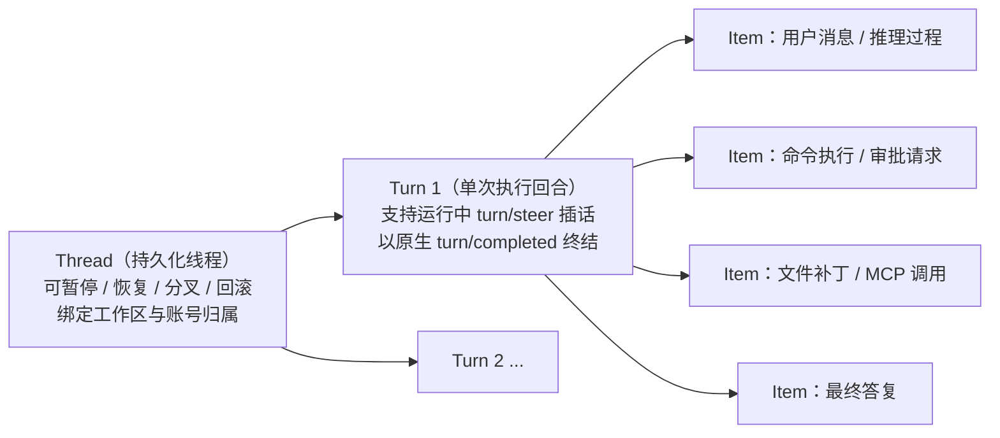

> [!FOCUS] 核心抽象
> Codex 没有把对话看成一维的“消息数组”，而是抽象出 **Thread（线程）→ Turn（回合）→ Item（结构化条目）** 三级模型，并围绕它构建了流式推理、上下文压缩、记忆摘要与扩展工具生态。

## 1. Thread / Turn / Item 三级领域模型

- **Thread（线程）**：长期持久化的对话与工作上下文单元（底层由 Rollout 日志与本地状态库共同支撑）。支持**按账号隔离历史**（切换登录账号不串历史）、**分叉（Fork）**出新线程做方案对比、以及**回滚（Revert）**到早期检查点。
- **Turn（回合）**：一次从用户输入触发到模型彻底完成任务（`turn/completed`）的完整执行周期。回合运行中支持通过 **`turn/steer`** 动态注入用户新指示，由 Codex 自身调度器在安全模型边界消化，而不必粗暴中断任务。
- **Item（条目）**：把工具调用、命令流式输出、人工审批弹窗、代码补丁全部建模为带唯一 ID 和生命周期的一等公民，UI 与第三方客户端只需订阅 Item 增量事件即可精准渲染。

---

## 2. 上下文管理与双轨压缩（Local vs Remote Compaction）

Coding Agent 动辄连续读几十个文件、跑十几轮测试，上下文很快撞上限。Codex 在上下文管理上体现了高度工程化的设计：

1. **预算化裁剪**：压缩时按 token 预算精细控制**保留的关键工具输出**、**多模态媒体预算**与**挂起中的用户输入**，避免把刚刚报错的测试日志一刀切压缩丢掉。
2. **双轨压缩能力**：既支持本地模型侧摘要压缩，也原生支持与 OpenAI 服务端协同的 **Remote Compaction（远端压缩与状态检查点）**，在长程 Coding 任务中降低客户端带宽与重传成本，并具备压缩模型回退机制。
3. **线程级记忆摘要**：每个已加载的线程可以维护结构化的**线程记忆摘要**，供跨轮回溯或客户端读取，且遵循线程级配置开关与版本隔离。

---

## 3. 工具与扩展生态设计

Codex 并没有把一切都塞进通用 Bash 命令里，而是按高频工程场景做了一套高信噪比的工具分层：

- **专用补丁编辑（`apply_patch`）**：用结构化 diff 补丁代替整文件重写，大幅降低长文件修改时的 token 消耗与幻觉破坏率；
- **代码执行模式（`code_mode`）**：允许模型在受限运行时内编写并执行紧凑脚本编排多步操作，减少“每查一步来回一轮 LLM”的往返开销；
- **标准生态接入**：原生内置 **MCP 客户端**（统一挂载外部工具与数据源）、**`AGENTS.md` 分层指令加载**（按目录层级自动发现仓库规范）、**Skills 技能包**、**Hooks 生命周期钩子**以及 **插件宿主（Plugin Host）**。
