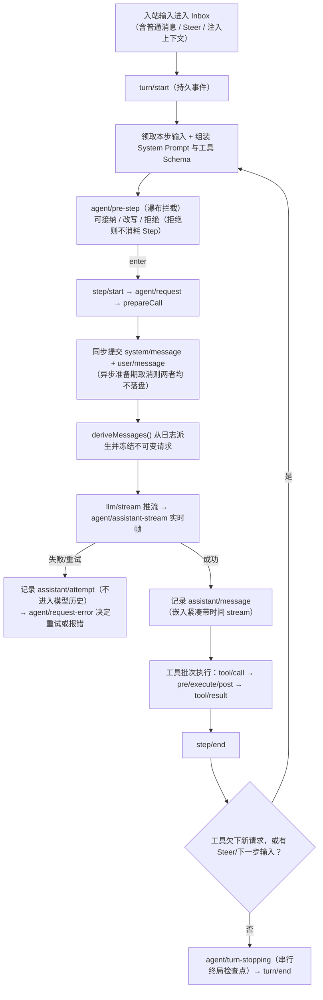

> [!FOCUS] 两大核心不变量
> 1. **“模型可见即已记录（Model-visible = Logged）”**：发送给大模型的每一帧历史都必须能从仅追加的 `SessionEvent` 日志通过纯函数 `deriveMessages()` 无损重建；
> 2. **三域事件解耦**：持久化回放事实、实时流程拦截、跨模块策略各自归属不同事件域，互不纠缠。

---

## 1. Turn 与 Step 的生命周期与三域事件

DeepSeek Harness 清晰区分 **Step（单次模型请求 + 它触发的工具批次）** 与 **Turn（零或多个 Step，从领取首条输入到不再欠下任何工作）**：

### 三域事件分工
- **Session Events（持久事实）**：`turn/*`、`step/*`、`system/message`、`user/message`、`assistant/message`、`assistant/attempt`、`tool/*`——凡是重启后仍需回放的状态都写进日志；
- **Agent Events（实时控制与拦截）**：
  - `agent/pre-step`、`agent/request`、`llm/stream`、`agent/request-error` 是 **waterfall（瀑布式）**，监听器必须显式调用 `next()` 才能往下委托；
  - `agent/turn-stopping` 是 **serial（串行终局检查点）**，允许插件在回合即将结束前做最后一次续跑或收尾检查；
- **Capability Events（能力策略）**：`fs/*`、`tools/*`（`pre-execute` / `execute` / `post-execute`）、`telemetry/*`，避免模块间循环依赖。

---

## 2. 不可变多代 JSONL 会话日志

- 物理存储采用追加式 `session.vN.jsonl[.zstd]`，支持在线压缩与多版本演进；
- **绝不原地改写旧代际文件**：当旧版本格式需要升级迁移时，系统解码校验后在旁边**排他发布新一代文件**，旧文件永不重命名或覆盖；
- **成功与失败流严格分离**：成功的 `assistant/message` 直接嵌入精确的带时间戳紧凑流；失败、重试或取消的尝试则记为 `assistant/attempt`（供遥测、排障和回放审计，但**绝不混入派生给模型的对话历史**）。

---

## 3. 模块化压缩家族（`packages/compaction`）

与其他框架把压缩逻辑写死在核心不同，DSH 把上下文瘦身拆成了 **4 个完全独立、可按需挂载的 Cordis 插件**：

1. **`compaction-tool-result-pruner`（前置修剪）**：在真正做摘要前先修剪超大工具输出，尽量少触发完整摘要；
2. **`compaction-basic`（压力与溢出压缩）**：
   - 在 `agent/pre-step` 监听 token 压力主动触发，在 `agent/request-error` 监听规范上下文溢出被动补救；
   - 触发时**先执行可选的工具结果修剪，再选择摘要**；恢复发生在当前仍打开的 Step 内部，**只有当修剪或摘要真正推进了替换代次时才发起重试**，避免原地死循环；
   - 压缩完成后通过 `system/message` 清空保留的系统增量、重建干净的系统头；
3. **`compaction-image-offload`（图片超限卸载）**：当支持视觉的路由因图片超出预算拒收请求时，在 `agent/request-error` 自动把超预算图片替换为占位文本；
4. **`command-compact`（`/compact` 手动命令）**：与运行中的轮次严格串行排队执行。
