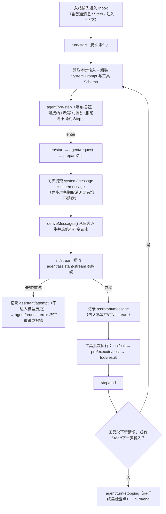

> [!FOCUS] 两大核心不变量
> 1. **“模型可见即已记录（Model-visible = Logged）”**：发送给大模型的每一帧历史都必须能从仅追加的 `SessionEvent` 日志通过纯函数 `deriveMessages()` 无损重建；
> 2. **三域事件解耦**：持久化回放事实、实时流程拦截、跨模块策略各自归属不同事件域，互不纠缠。

---

## 1. Turn 与 Step 的生命周期与三域事件

DeepSeek Harness 清晰区分 **Step（单次模型请求 + 它触发的工具批次）** 与 **Turn（零或多个 Step，从领取首条输入到不再欠下任何工作）**：

### 三域事件分工
- **Session Events（持久事实）**：`turn/*`、`step/*`、`system/message`、`user/message`、`assistant/message`、`assistant/attempt`、`tool/*`——凡是重启后仍需回放的状态都写进日志；
- **Agent Events（实时控制与拦截）**：
  - `agent/pre-step`、`agent/request`、`llm/stream`、`agent/request-error` 是 **waterfall（瀑布式）**，监听器必须显式调用 `next()` 才能往下委托；
  - `agent/turn-stopping` 是 **serial（串行终局检查点）**，允许插件在回合即将结束前做最后一次续跑或收尾检查；
- **Capability Events（能力策略）**：`fs/*`、`tools/*`（`pre-execute` / `execute` / `post-execute`）、`telemetry/*`，避免模块间循环依赖。

### 工具执行流水线的三大精细设计（`dsh-tools`）
1. **规范输出契约（Canonical Output）**：每个注册工具不仅声明入参 Schema，还必须声明**无损 JSON 输出 Schema** + 两个纯函数投影：`render(args, value)`（给模型看的内容块）与 `presentCall` / `presentResult`（无副作用的 UI 展示意图——实时流与历史日志回放共用同一套纯函数，保证刷新后 UI 零漂移）；
2. **显式并发安全分类器（`isConcurrencySafe(args)`）**：模型单步发出多个工具调用时，只有显式返回 `true` 的调用才会进入并发滚动池，其余自动落入串行屏障（Barrier），且在真正启动前按参数动态分类；
3. **严格白名单防元数据泄漏**：面向模型的 `schemas()` 仅暴露 `name` / `description` / `parameters`，`timeoutMs`（协作超时预算）、`isConcurrencySafe`、`execute` 等宿主元数据绝不进入模型上下文。

---

## 2. 不可变多代 JSONL 会话日志

- 物理存储采用追加式 `session.vN.jsonl[.zstd]`，支持在线压缩与多版本演进；
- **绝不原地改写旧代际文件**：当旧版本格式需要升级迁移时，系统解码校验后在旁边**排他发布新一代文件**，旧文件永不重命名或覆盖；
- **成功与失败流严格分离**：成功的 `assistant/message` 直接嵌入精确的带时间戳紧凑流；失败、重试或取消的尝试则记为 `assistant/attempt`（供遥测、排障和回放审计，但**绝不混入派生给模型的对话历史**）。

---

## 3. 模块化压缩家族（`packages/compaction`）

与其他框架把压缩逻辑写死在核心不同，DSH 将压缩建模为可选能力接缝（**不属于 Agent Loop 主干**），拆成 **4 个独立可插拔 Cordis 插件**，并引入了极其严谨的**日志锁 + 位置遮蔽**机制：

1. **日志级事务锁（防半成品压缩污染）**：
   - 压缩全流程由三类仅写入日志的事件括住：**先追加 `compaction/start`（加锁） → 写入 `compaction/summary` 与带 `surfaceOp: { op: 'replace', startSeq, endSeq }` 的替换检查点 → 最后才追加 `compaction/end`（解锁）**；
   - 如果压缩中途进程崩溃，日志里会留下未配对的 `compaction/start`，系统一眼识别为遗留锁而非“假装压缩成功”。
2. **先修剪再摘要，能省一次 LLM 就省一次**：
   - `compaction-basic` 在 `agent/pre-step` 响应 token 压力、在 `agent/request-error` 响应规范溢出；
   - 一旦触发，**先调用可选的 `compaction-tool-result-pruner` 修剪超大工具输出**（每条修剪记录 `originalSeq` / `replacementSeq` 与削减字符数），再用单例 `ctx.tokenMeter` 重新测量——**如果修剪完已经够用，直接推进替换代次，完全省掉一次摘要模型调用！**
3. **位置跨度遮蔽与超大单轮切分**：
   - 因为日志仅追加、旧事件永不删，摘要检查点通过 `shadowedSeqs` 精确遮蔽被替代的旧节点；
   - 边界只需保证**工具调用/结果配对平衡**（`toolPairingBalancedBefore/After`），不必卡死整个 Turn，因此一个超大轮次里已经闭合的早期步骤也可以提前压缩；
   - 默认用产生最新助手消息的路由来生成摘要，避免“首次请求就溢出的新路由”替自己做摘要失败。
4. **图片超限卸载（`compaction-image-offload`）与手动 `/compact`**：
   - 当支持图片的路由因图片超预算拒收时，按精确的 `(seq, imageIndexes)` 持久化卸载为占位文本；手动 `/compact`（`command-compact`）则作为轮次间维护与排队提示词严格串行。
