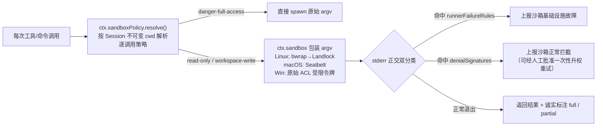

> [!FOCUS] 能力接缝的威力
> 在 DeepSeek Harness 中，**沙箱、PTC 代码执行、Browser Use、Computer Use 与多 Agent 协作**全部遵循同一套「Service Definition + Provider + Consumer」接缝模型，彼此隔离又可自由替换。

---

## 1. 三端本地进程沙箱：逐调用策略、诚实降级与故障分类

`packages/sandbox` 将子进程执行限制在三档文件效果策略之下：**`read-only`（只读）**、**`workspace-write`（仅工作区与私有临时目录可写）**、**`danger-full-access`（绕过隔离）**，被策略拦截的命令支持经用户批准做**一次性升权重试**。此外还有四个非常硬核的工程细节：

1. **各平台后端选型与 Windows 特殊取舍**（可对照 [AI Agent 沙箱技术全景 → 第 2 章](#/agent-sandbox/process-and-runtime)）：
   - **Linux**：优先 **`bwrap`（Bubblewrap）**，环境不支持时回退到 **Landlock LSM**；
   - **macOS**：原生 **Seatbelt**；
   - **Windows**：专门维护 `sandbox-windows-acl`，**刻意选用原始 ACL 受限令牌（Restricted Token）而非 AppContainer**——每个存活 Session/工作区分配随机私有临时目录与专属 SID，既把写权限锁死在工作区与临时目录，又避开了 AppContainer 导致本地编译器/CLI 工具链大面积不兼容的痛点；
   - **SSH 远端沙箱（`dsh-sandbox-ssh`）**：与 SSH 文件系统及子进程提供方配套，在远端机器执行同一套文件策略。
2. **逐调用策略（Per-Call Policy）**：策略不绑死在后端实例上，而是每次调用携带——同一时刻，并发的 Bash 可跑 `read-only`，而受限子 Agent 可写自己的状态目录；获批提权重试只需用更宽的策略发一次新调用。
3. **诚实上报强制完整性（`full` vs `partial`）**：当宿主机是较老的 Landlock ABI，或 Windows ACL 存在硬链接/读取不受限缺口时，后端必须如实上报 `enforcement: "partial"`，**绝不谎称完全隔离**，要求绝对边界的调用方据此决定拒绝或向上警示。
4. **正交双分类器（`denialSignatures` vs `runnerFailureRules`）**：将“沙箱正常工作拦住了越权命令”与“沙箱 Runner 自身在执行命令前就崩溃/失败”严格区分，优先把后者作为基础设施故障上报，而非普通任务失败。
5. **清晰架构划界**：`ctx.sandbox` **仅管控与宿主机共享内核的本机子进程文件效果**（不含网络与进程可见性）；需要容器、MicroVM 或远程执行器时，直接替换上层 `ctx.fs` + `ctx.subprocess` 整个能力接缝。

---

## 2. PTC 运行时（Programmatic Tool Calling · `run_code`）

面对需要连续查几十个文件、做复杂过滤聚合的任务，传统一轮调一次工具极其浪费延迟与 Token。DSH 独立抽出了 **`packages/ptc-runtime`**（同样作为可选能力接缝，不属于循环主干）：

- **四种源码求值形态（`programFormat`）**：
  1. **`function-body`**（异步函数体）：支持顶层 `await` 与 `return`，每次独立新进程；
  2. **`repl`**：持久共享作用域，多轮调用共享变量状态；
  3. **`scoped-repl`**：每次调用拿到之前顶层绑定的拷贝，允许重新声明同名变量而不破坏旧代码；
  4. **`script`**：自动降级转换顶层 `await` 并取末尾表达式作为完成值，按 `scriptPersistence` 可选保留内存状态。
- **安全的宿主绑定注入**：宿主工具以命名空间全局对象（如 `tools`）暴露为异步函数，所有参数与返回值必须过无损 JSON 边界，且绑定名全部设为自有属性防止 `__proto__` 原型链遍历攻击；
- **硬中止与结果化报错**：`AbortSignal` 可在死循环中途硬停程序；程序异常不会抛成框架崩溃，而是写入 `PtcRunResult.error` 字段（同时独立报告沙箱模式与是否被拒绝），交给模型直接诊断自愈。

---

## 3. 独占注册的 Browser Use、Computer Use 与多 Agent 团队

- **Browser Use（`ctx.browserUse`）与 Computer Use（`ctx.computerUse`）**：
  - 两者都采用**独占具名提供方注册表**（防止同一配置树同时启用多个浏览器/桌面提供方造成工具冲突）；
  - 实验包已覆盖 **Playwright MCP、Chrome DevTools MCP、Stagehand**（Browser Use）以及原生 **CUA + Cua Driver**（Computer Use，带权限管理组合包），详见 [Browser Use 与 Computer Use](#/gui-automation/overview)。
- **Subagent 与 Agent Teams**：
  - `subagent` 接缝背后可以千差万别——既可以本地派生一个子 Agent，也可以把一轮任务委派给外部其他产品；
  - 根会话开启 **Agent Teams** 后，提供共享任务板与任务策略，配合普通 Subagent 控制工具实现身份、通信、发现、中断与收件箱等待。
