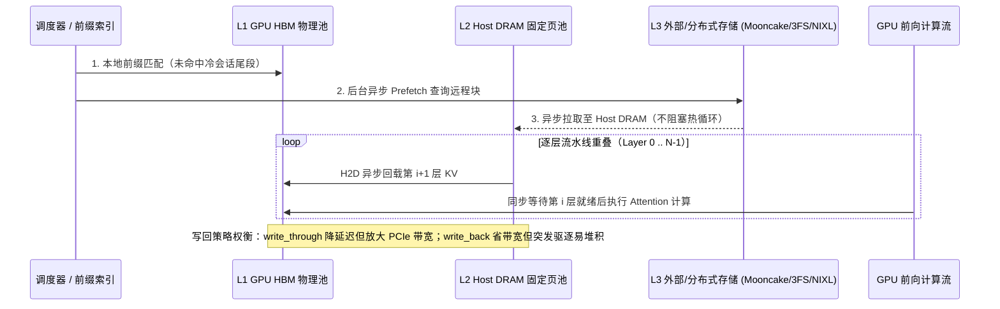

> [!FOCUS] Prompt Cache 为什么能把延迟和成本打下 5–10 倍？
> 多轮 Agent 会话里，系统提示词、工具 Schema 和早期对话往往占到每轮输入 Token 的 **85%–95%**。由于因果自注意力（Causal Attention）中每个 Token 的 K/V 只依赖它和它之前的 Token，只要输入前缀**字节级完全一致**，推理引擎就可以直接复用此前算好的 KV Cache 物理页，把原本几万 Token 的 `O(n²)` Prefill 缩成只算最后几百个新增 Token。

---

## 1. 前缀缓存的物理铁律：为什么改第 100 个字节后面全废？

自注意力层的依赖关系是一条**严格单向因果链**：位置 `i` 的隐藏态依赖 `0..i-1` 的全部 K/V，因此前缀缓存索引天然采用**链式哈希（Block-chained Hash）**或**前缀树（Radix Tree）**：

- 只要序列开头的第 100 个字节变了（比如在 System Prompt 顶部插入精确到秒的动态时间），从该块起后续所有块的父哈希与注意力分布全部失效，几万 Token 被迫冷启动全量重算；
- 这直接解释了上层工程的一系列硬法则：
  - [工业级 System Prompt 法则 1](#/system-prompts/engineering-principles)：静态指令置顶、动态环境与 `WorldState` 增量后置；
  - [Anthropic 显式 `cache_control` 断点](#/llm-protocols/anthropic-messages) 与 [OpenAI Responses 自动前缀缓存](#/llm-protocols/openai-responses)：前者需要显式标出写缓存水位与 5m/1h TTL，后者自动按前缀匹配并计费；
  - [DeepSeek Harness 带外协议扩展](#/deepseek-harness/wire-extensions)：绝不往提示词里塞遥测字段，改用独立 HTTP Header 保证零前缀污染；
  - [Pi 摘要主动关闭缓存写](#/pi/loop-and-compaction)：一次性压缩总结的 Prompt 永远不会再被下一轮复用，写缓存只会白白多付 Cache Write 溢价；
  - [OpenClaw 等 TTL 过期再修剪](#/openclaw/agent-loop/compaction)：在热缓存期内盲目删改中间旧工具结果会破坏前缀连续性，反而导致缓存击穿。

---

## 2. 三大引擎的核心前缀索引与内存池横评

为了解决显存碎片并实现跨请求零拷贝 KV 共享，三家引擎全部基于**分页物理池（Paged KV）**构建，但在前缀索引数据结构、混合架构支持与驱逐安全策略上走出了三种极具代表性的设计：

| 维度 | vLLM V1 (`9cd5cde`) | SGLang (`dacaf1d7`) | TensorRT-LLM `1.4.0rc5` (`e627ac85`) |
|---|---|---|---|
| **核心管理类** | `KVCacheManager` → `KVCacheCoordinator` → `BlockPool` | `UnifiedRadixCache`（`UnifiedTreeCore` / Rust 核）+ `ReqToTokenPool` / `TokenToKVPool` | C++ `KVCacheManager`（V1 默认）与新一代 C++ **`KVCacheManagerV2`**（经 nanobind 零拷贝绑定） |
| **前缀索引结构** | **链式定长块哈希** `hash_block_tokens(parent_hash, tokens, extra_keys)` 存入 `BlockHashToBlockMap` | **显式基数树**（`TreeNode` + `RadixKey`），命中边中间时调用 `_split_node` 动态裂变 | V1：`BlockManager` 共享前缀树 `mCachedBlocksRoot`；V2：**`BlockRadixTree`** 强制 **32 字节 SHA-256 链式哈希** |
| **多租户 / 多模态隔离** | `extra_keys` 自动混入多模态特征哈希、LoRA ID、`prompt_embeds` 哈希 | `RadixKey.extra_key` 隔离 LoRA Adapter、cache salt 与 cache version | `ReuseScope(loraId, salt)` + **密码学 SHA-256**（源码明示严禁换非密码学哈希，杜绝无明文二次比对时的跨租户碰撞泄漏） |
| **混合模型（Full + SWA + Mamba）** | **HMA**（`HybridKVCacheCoordinator`）：各组共享物理页池，以**单调递减固定点迭代**协商共同最长命中，支持 Mamba 打点与 COW | `UnifiedRadixCache` 单棵树统一承载 Full KV、SWA 与 Mamba 状态检查点；配合 `HybridReqToTokenPool` | V1：`WindowBlockManager` 按窗口分组 + SSM 池；V2：**`LifeCycleRegistry`** 统一建模为 `CacheGroupId`（支持 `REQUIRED` / `OPTIONAL` / `PRIVATE`） |
| **在途保护与驱逐策略** | **O(1) 侵入式双向链表 LRU**（`FreeKVCacheBlockQueue`）；释放时按**逆序**入队，保证**尾块先于公共前缀头块被驱逐** | `inc_lock_ref` / `dec_lock_ref` 沿父链锁定共享路径；最小堆按可插拔策略驱逐无子叶节点（默认 `LRU`，含 **`TLRUStrategy`** 按 TTFT 预算裁尾、`StateCostStrategy`） | V1：两阶段 **claim-then-onboard** 防批内互逐 + `LRUEvictionPolicy` 支持**层级 × 业务保留优先级**二维队列；V2：`EvictionController` 统一管控 |

> [!TIP] 看懂三种前缀索引的工程取舍
> - **vLLM V1（链式块哈希）**：实现最轻量，查表和驱逐全部严格 `O(1)`，且天然适配 HMA 多异构注意力组；代价是命中粒度受限于固定 `block_size`（常见 16 tokens），对非对齐细粒度分叉略逊于显式树（通过 `cache_aware_window` 排序和 Mamba `partial_hash_hits_enabled` 弥补）。
> - **SGLang（显式基数树）**：天然把整个多轮/多分支会话家族（如 Tree-of-Thought 或并行子 Agent 探索）组织成一棵可见的树，配合 `LPM` 调度和 `TLRUStrategy` 能把前缀局部性压榨到极致；高 QPS 下的 Python 树分裂开销已通过 `rust_tree_core` 缓解。
> - **TensorRT-LLM V2（C++ SHA-256 基数树）**：同时拿下 C++ 低开销、企业级多租户密码学安全（不依赖明文二次比对也不怕哈希碰撞串数据）以及按业务优先级锁住热点系统提示词（`KvCacheRetentionConfig`）的能力。

---

## 3. 多级 KV 卸载：突破单卡 HBM 容量天花板

单张 80GB/192GB GPU 扣除模型权重后，留给 KV Cache 的热显存非常有限。面对长程多轮 Agent（用户思考 30 秒或等待外部工具执行期间，会话 KV 若被驱逐，下一轮就会触发惨烈的全量重算），三家引擎均构建了 **L1 HBM → L2 Host DRAM → L3 分布式存储** 的分级卸载体系：

三家引擎的分级卸载落地差异如下：

- **SGLang `HiCache`（原生深度整合 L1/L2/L3）**：
  - 由 `HiCacheController` + `HostKVCache`（支持 `layer_first` / `page_first` / `page_unified` 布局）与 `StorageBackendFactory` 驱动，内置 **13 种 L3 后端**（`mooncake`、`nixl`、`hf3fs`、`aibrix`、`fast_file`、`seaweedfs` 等）并支持 `LMCacheUnifiedRadixCache` / `FlexKV`；
  - 亮点是通过 **`LayerDoneCounter`** 实现**逐层生产-消费异步回载**——算第 `i` 层时并行把第 `i+1` 层 KV 从 L2 拉回 L1，将 PCIe 搬运延迟隐藏在计算之后；支持 `write_through` 与 `write_back` 两种写策略。
- **vLLM V1 `KVConnectorBase_V1`（标准双角色解耦接口）**：
  - 将连接器严格拆分为 `KVConnectorRole.SCHEDULER`（`get_num_new_matched_tokens` 查远程命中）与 `KVConnectorRole.WORKER`（`start_load_kv` / `wait_for_layer_load` / `save_kv_layer` 嵌入前向流水线）；
  - 统一承载 `OffloadingConnector`、`LMCacheConnectorV1`、`MooncakeStoreConnector`、`HF3FSKVConnector`、`NixlConnector` 等生态插件，并可用 **`MultiConnector`** 将“本地 CPU/NVMe 卸载”与“跨机 NIXL PD 传输”串联编排。
- **TensorRT-LLM 1.4（原生四级 `StorageManager` + Connector）**：
  - V2 原生内置四级存储编排 **`StorageManager`**（GPU HBM → Host DRAM → Disk → Remote Memory），包含 `CopyEngine`、冷页编解码 `ColdPageCodec` 及 GPUDirect Storage（`GDS`）；
  - 同时提供双端解耦的 `KvCacheConnector`（`KvCacheConnectorScheduler` / `KvCacheConnectorWorker`），仓库自带 **NVIDIA Dynamo KVBM**、**LMCache** 与 **Mooncake Store** 现成接入配置。

---

## 4. 跨节点 Cache-Aware Routing：为什么不能用普通轮询？

在多副本集群里，如果入口网关仍采用无状态的 Round-Robin（轮询）负载均衡，一个 10 轮对话的 Agent 会被随机打到 8 台不同机器上——**每台机器本地都只有冷缓存，单机再强的 RadixCache 命中率也会瞬间暴跌到 10% 以下**。

三家引擎的集群级解决方案高度一致——**引擎吐出 KV 块变更事件 + 上层路由器维护全局前缀/会话视图**：

| 引擎 | KV 事件发布机制 | 缓存感知与会话亲和路由 | 工程边界与注意点 |
|---|---|---|---|
| **SGLang** | Worker 通过 `ZmqEventPublisher` 发布 `BlockStored` / `BlockRemoved` / `AllBlocksCleared` | 内置 Rust 路由器 **`sgl-router`** + **`sgl-kv-indexer`**（gRPC 内存全局树）：`CacheAwarePolicy` 在高命中 Worker A 与 Power-of-Two 低负载 Worker B 间按 `load_factor`/`load_gap` 权衡（计算负载时自动扣除 A 已缓存前缀）；另支持 `SessionAwarePolicy` | `sgl-kv-indexer` 当前为单点内存软状态，重启后需重新预热，不提供 HA 复制 |
| **TensorRT-LLM 1.4** | C++ `KVCacheEventManager`（V1）或 `EventManager`（V2）通过 `/kv_cache_events` 暴露事件（含 `cacheLevel`、`priority`、`cacheSalt`） | 内置 **`KvCacheAwareRouter`**（自动兼容 V1 与 V2 SHA-256 哈希）与面向多轮 Agent 的 **`ConversationRouter`**（基于 `conversation_id` LRU + 内容步进 `blake3` 哈希，且原生支持子 Agent 亲和 **`subagent_affinity_id`**） | 支持配合 `SeatPool` 全局并发席位背压，避免热门前缀把单节点打穿 |
| **vLLM V1** | `KVCacheManager.take_events()` 汇总全节点块创建与驱逐事件供外部订阅 | 引擎核心保持克制，专注单节点与 DP 内 `DPCoordinator` / `DPLBAsyncMPClient` 负载均衡；跨节点前缀亲和交由外置路由层（如 vLLM Router / Gateway）消费 KV Events 实现 | 解耦灵活，易融入已有 K8s / Envoy AI 网关体系，但需额外部署维护路由控制面 |

> [!WARNING] 多副本集群的“热点雪崩”陷阱
> **缓存命中率并非越高越好**。如果 200 个共享同一份超长系统提示词的并发 Agent 全被死板地路由到同一台已有缓存的 Worker，该节点队列会瞬间爆炸，TTFT 反而不如打到空闲节点重算。因此生产路由必须像 `sgl-router` 的 `balanced` 模式那样，在**“省下的 Prefill Token 数”与“目标节点当前排队负载”**之间做动态权衡。
