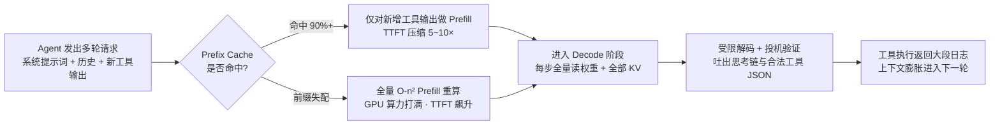

> [!FOCUS] 为什么 Agent 架构师必须看穿推理引擎？
> 上层 Agent 框架里那些看似“玄学”的工程铁律——**Prompt Cache 静动切分带来 5–10 倍成本差**、**工具读完大文件后下一轮首字卡顿十秒**、**标称 200K 窗口却必须在 75% 提前压缩**——背后全都是 GPU 算力、HBM 显存带宽与 KV Cache 物理规律的直接投影。


---

## 1. Prefill vs Decode：TTFT 与 TPOT 的物理根源

大模型自回归推理天然分裂为**物理性质截然相反的两个阶段**。理解这一分裂，是读懂现代推理引擎所有调度、缓存与分离架构的第一步：

| 维度 | Prefill（首字计算阶段） | Decode（逐字生成阶段） |
|---|---|---|
| **对应体感指标** | **TTFT**（Time To First Token，首字延迟） | **TPOT**（Time Per Output Token，单字生成耗时） |
| **计算形态** | 整段 Prompt（数千～数十万 Token）一次性并行矩阵乘（GEMM） | 每次仅输入最新 1 个 Token，与历史 KV 做向量-矩阵乘（GEMV） |
| **硬件瓶颈** | **Compute-Bound（算力受限）**，高算术强度，打满 Tensor Core | **Memory-Bandwidth-Bound（显存带宽受限）**，极低算术强度，卡在 HBM 搬运 |
| **Agent 典型触发** | 首轮加载系统提示词 + 工具表；每轮工具返回大段代码/日志后重算增量 | 流式输出 `<think>` 思考链、工具调用 JSON 参数与最终代码补丁 |
| **核心优化杠杆** | Prefix Caching、Chunked Prefill、FlashAttention/FlashMLA、PD 分离 | Continuous Batching、投机解码（EAGLE3/MTP）、GQA/MLA、FP8/NVFP4、CUDA Graph |

在多轮工具循环中，这两类瓶颈会反复交替冲击 Agent 的端到端耗时：



> [!TIP] 一句话建立 Roofline 直觉
> **Prefill 拼的是卡的算力（FLOPS）**，单请求足够长就能吃满 GPU；**Decode 拼的是显存带宽（TB/s）**，单请求并发时 GPU 95% 以上的算力都在空等 HBM 把模型权重和历史 KV 搬进 SRAM——这就是为什么必须靠批处理把权重读取摊薄到几十个并发会话上，也解释了为什么单路 Agent 提速高度依赖投机解码。

---

## 2. KV Cache 显存账本：MHA → GQA → MLA

自回归生成之所以不必每吐一个新字就把历史全部重算一遍，靠的是把每一层已经算出的 Key 与 Value 向量缓存在显存里（即 **KV Cache**）。单 Token 的物理显存账本由一个极其朴素的公式决定：

```text
单 Token KV 显存 = 2 (K 和 V) × L (层数) × H_kv (KV 头数) × d_head (单头维度) × precision_bytes
```

随着 Agent 上下文动辄冲上 64K–200K，KV Cache 很快就会反超模型权重本身，成为显存容量与 Decode 带宽的双重杀手。模型架构演进的十年主线，几乎都在压缩这个乘积：

| 注意力架构 | 核心压缩原理 | 相对 MHA 的单 Token KV 体积 | 工程与推理引擎影响 |
|---|---|---|---|
| **MHA（多头注意力）** | 每个 Query 头独占一组 K/V 头（`H_kv = H_q`） | **100%（基准）** | 70B 级模型 128K 上下文单请求即可吃掉 >300 GB 显存，极难承载高并发长上下文 |
| **GQA（分组查询注意力）** | 多个 Query 头共享同一组 K/V 头（如 `H_q=64, H_kv=8`） | **~12.5%（8× 压缩）** | Llama / Qwen 等主流稠密与 MoE 模型标配，精度几乎无损 |
| **MLA（多头潜在注意力）** | DeepSeek 系列将 K/V 联合低秩投影压缩为单一潜在向量 `c_KV`（如 `d_c=512`）加解耦位置编码 `k_R`（`d_r=64`） | **~3%–5%（20×+ 压缩）** | 极大拉升单卡并发上下文；推理引擎需专用 `MLATokenToKVPool` / `FlashMLA` 并将权重吸收进矩阵乘 |
| **混合架构（SWA / Mamba / Linear）** | 仅部分层保留全注意力，其余层采用滑动窗口（固定上限）或常数级 SSM 状态 | **随层比例大幅封顶** | 引擎必须升级为混合内存分配器（如 vLLM HMA、SGLang `UnifiedRadixCache`、TRT-LLM `LifeCycleRegistry`） |

在此基础上，现代引擎进一步叠加 **FP8 / MXFP8 / NVFP4 KV Cache 量化**（将 `precision_bytes` 从 2 字节压到 1 字节甚至 0.5 字节），把单卡可驻留的并发 Agent 会话数再翻 2–4 倍。

---

## 3. 长上下文物理悬崖与 Context Rot

很多工程师会有直觉误区：“既然模型标称支持 200K 甚至 1M 窗口，为什么还要花这么大精力写复杂的裁剪与压缩？”底层推理原理给出了两个无法绕开的硬约束：

1. **硬件成本双悬崖**：Prefill 阶段的自注意力计算量随上下文长度按 `O(n²)` 增长（即使 FlashAttention 把显存占用压到 `O(n)`，计算量仍是二次方）；Decode 阶段每吐 1 个 Token 都要把整个历史 KV Cache 从 HBM 全量扫一遍，上下文拉长 10 倍，单步 KV 带宽消耗与延迟就线性暴涨 10 倍。
2. **有效窗口与 Context Rot（上下文腐烂）**：受 RoPE 位置编码长距外推衰减与 Softmax 注意力稀释效应影响，当历史里塞满几十轮过期的终端报错、整文件读取快照和旧指令增量时，模型对中段关键约束的召回率会断崖下跌（Lost-in-the-Middle）——**“塞得进去不报错”远不等于“模型还能准确推理”**。

> [!IMPORTANT] 串联五家主流 Agent 的压缩设计
> 正是这堵物理墙，倒逼五家工业级 Agent 在不同工程路径上殊途同归：
> - [OpenClaw 上下文修剪与压缩](#/openclaw/agent-loop/compaction)：按 75% 窗口水位线触发压缩，并结合 TTL 先修剪旧工具结果再做四段配额摘要；
> - [Codex 压缩与 WorldState](#/codex/core/compaction)：用后台投机预压消除压缩卡顿，并在新窗口丢弃历史碎片重算唯一干净的 `WorldState`；
> - [OpenCode 门铃循环与四级降采样](#/opencode/loop-and-compaction)：预留吸收带并逐级降采样工具结果，防止突然溢出；
> - [Pi 追加式非破坏压缩](#/pi/loop-and-compaction)：用 `CompactionEntry` 切分历史且在摘要请求主动关闭缓存写；
> - [DeepSeek Harness 模块化压缩](#/deepseek-harness/loop-and-compaction)：基于不可变多代事件日志把压缩彻底插件化。

---

## 4. 2026 三大开源推理引擎的架构收敛与核验基线

越过 HTTP 推理协议边界（参见 [大模型推理协议演进全景](#/llm-protocols/overview)）往下看，当前生产级自托管推理世界由 **vLLM V1**、**SGLang** 与 **TensorRT-LLM** 三强主导。本专题全部机制均基于 2026-11-24 一线源码实证核验，**三家在 2026 年都经历了决定性的范式演进**：

| 引擎 | 源码核验基线（2026-11-24） | 2026 核心架构演进（实证纠偏） | 核心设计定位 |
|---|---|---|---|
| **vLLM V1** | `vllm-project/vllm` `@ 9cd5cde` | **V0 已彻底退出**，`AsyncLLM` + `EngineCoreProc` + 模块化 V2 `GPUModelRunner` 成为唯一生产架构 | **极简对称核心 + 硬件中立插件生态**：首发模型覆盖最广、组件正交解耦 |
| **SGLang** | `sgl-project/sglang` `@ dacaf1d7` | 默认收口至 **`UnifiedRadixCache`**（含 Rust 树核）；**主线已移除通用 FSM jump-forward**，全面转向 XGrammar/LLGuidance + Overlap + 投机解码协同 | **树状前缀原语 + 一体化高性能栈**：多轮/多分支前缀共享、HiCache 与 Rust `sgl-router` 深度闭环 |
| **TensorRT-LLM 1.4** | `NVIDIA/TensorRT-LLM` `1.4.0rc5 @ e627ac85` | **传统离线 `.engine` TRT 后端已彻底移除**，统一为 **`backend="pytorch"`** + C++ nanobind 核心状态机（`KVCacheManagerV2`）+ 原生 Anthropic `/v1/messages` | **PyTorch 敏捷前端 + NVIDIA 芯片级极限内核**：Blackwell/Rubin NVFP4、`trtllm-gen`、多租户 SHA-256 隔离 |

> [!NOTE] 本专题阅读导览
> - 搞懂 **Prompt Cache 为何值 5–10 倍成本差**、三家前缀树/哈希表、多级卸载与缓存路由 → 下一篇 [02 · KV Cache 与 Prefix Caching](#/inference-engines/kv-cache-and-prefix)；
> - 搞懂 **连续批处理、CPU/GPU 重叠、PD 分离、投机解码、受约束解码与 Wide-EP MoE** → [03 · 调度器、合批与加速栈](#/inference-engines/scheduling-and-acceleration)；
> - 追踪 **一条多轮工具调用请求在三家引擎内的完整源码路径与选型矩阵** → [04 · 三家引擎源码架构横评](#/inference-engines/three-engines-architecture)。
