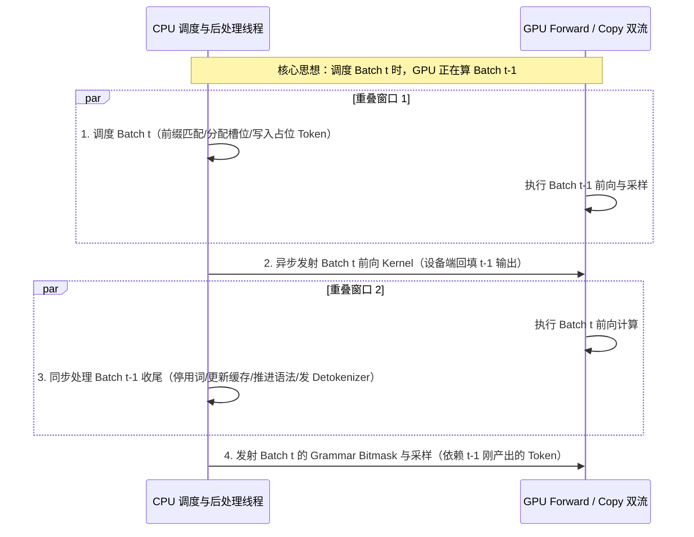

> [!FOCUS] 现代推理引擎调度与加速的核心命题
> 在真实 Agent 线上流量里，**几万 Token 的工具返回（超长 Prefill）**、**几十路并发流式吐字（低 TPOT Decode）**、**严格 JSON Schema 工具调用**与**超长 `<think>` 思考链**会同时涌进同一台 GPU 集群。这一章拆解三家引擎如何通过调度重叠、PD 分离、投机解码、受约束解码与 Wide-EP MoE 把这四个互相打架的目标拧成合力。

---

## 1. Continuous Batching 与 Chunked Prefill：消除队头阻塞

早期静态批处理必须等同一批里最长的请求生成完才能释放槽位，GPU 大量空转；迭代级**连续批处理（Continuous Batching / In-Flight Batching）**改为每生成 1 个 Token 就重新组批，随时有请求结束就立刻补入新请求。

但 Agent 场景立刻引出新矛盾：**某会话刚读完 30K 行代码发来超长 Prefill，若一次性整段算完需要 2 秒，同机正在流式吐字的 30 个其他会话就会集体卡死 2 秒（Head-of-Line Blocking）**。解法就是 **Chunked Prefill**——把超长 Prompt 按固定切片（如 2K–8K tokens）拆成多步，每步与在途 Decode 混合执行。

三家引擎在 2026 年的调度器演进呈现出清晰分叉：

| 引擎 | 调度核心模型 | 排队排序与防饿死 / 防雪崩机制 | 显存不足抢占策略 |
|---|---|---|---|
| **vLLM V1** | **完全对称的 `token_budget` 模型**（`Scheduler.schedule`）：彻底取消 V0 分离的 Prefill/Decode 阶段，默认开启 Chunked Prefill，统一按 `num_computed_tokens` 追赶目标长度 | 先保 `running` 再纳 `waiting`；`long_prefill_token_threshold` 防止单个长 Prompt 独占预算；`cache_aware_window` 重排等待队列提升前缀局部性 | **纯重算抢占**：释放尾部/低优先请求的 KV 块并重置进度放回队头（彻底移除 V0 复杂低效的 CPU Swap 路径） |
| **SGLang** | **Prefill 优先连续批处理**（`get_next_batch_to_run`）：有可接纳新请求时优先做 Prefill（辅以 `prefill_decode_interval` 保护大 Decode 批的 TPOT），支持自适应 `chunked_prefill_size` 与 `--enable-mixed-chunk` | 默认 **`LPM`（最长前缀匹配）**+ `bounded_lpm` 防饥饿；另有 `dfs-weight`、`hrrn`、`uniboost` 等树感知与尾延迟策略 | 显存耗尽时执行 **Retraction** 回退部分 running 请求（可释放或经 `UnifiedRadixCache.backup_kv_cache` 暂存 Host 内存） |
| **TensorRT-LLM 1.4** | V1 为 C++ `CapacityScheduler`（`MAX_UTILIZATION` / `GUARANTEED_NO_EVICT`）+ `MicroBatchScheduler`；V2 为统一 **`KVCacheV2Scheduler`**（`BudgetTracker` + `PrefixWaitPlanner`） | **`beneficialToSkip()`**：检测到前序在途 Prefill 即将产出相同前缀块时，主动暂缓后续同前缀请求，**杜绝并发冷启动雪崩重算**；内置 **`AgentTree`** 按比例混合调度 Agent 与 Chatbot 流量；`reuse_adjusted_compute()` 仅对未命中前缀扣减预算 | V1 支持 `GUARANTEED_NO_EVICT` 预留全周期显存或 `MAX_UTILIZATION` 暂停低优请求；V2 支持可配置生成抢占 `gen_preemption` |

---

## 2. Zero-Overhead CPU/GPU 异步重叠调度

当单步 Decode 在现代 GPU 上被压缩到 5–15 毫秒时，如果每步都要“GPU 算完 → 同步拷回 CPU → CPU 跑 Python 调度和前缀匹配 → 再发射下一步”，CPU 侧 2–3 毫秒的“调度税”会直接吃掉 20%+ 吞吐。

三家引擎在 2026 年**不约而同把 1-Step CPU/GPU 异步重叠作为主力默认路径**：

- **SGLang `event_loop_overlap`**：双流（`forward_stream` + `copy_stream`）配合 **`FutureMap`**——调度 Batch `t` 时用负索引占位未知的上一步输出，在 GPU 侧直接把 Batch `t-1` 的设备输出张量回填为 Batch `t` 的 `input_ids`，无需 CPU 等待同步；
- **vLLM V1 `AsyncScheduler` & `EngineCore.step()`**：Worker 侧在 UVA 内存持久化维护 `RequestState` / `InputBuffers` / `BlockTables`，每步只传增量 `SchedulerOutput`；`AsyncScheduler` 用 `num_output_placeholders` 提前规划下一批，且在 GPU 执行 `execute_model(non_block=True)` 期间并发在 CPU 侧计算 `get_grammar_bitmask()`；
- **TensorRT-LLM `_executor_loop_overlap()`**：在 `pp_size == 1` 时默认开启，发射本轮前向（消费 `previous_tensors_device`）的同时在 CPU 并行执行上一轮 KV 延迟释放、响应推送与分离部署异步推 KV（`_send_kv_async`）。

---

## 3. PD 分离（Prefill-Decode Disaggregation）

即使开了 Chunked Prefill，只要 Prefill 和 Decode 共处同一张卡，高算力需求的 Prefill 切片仍不可避免地拉高 Decode 的 TPOT 尾延迟，且两者最优的并行切分策略（TP/DP/EP）截然不同。**PD 分离**将集群物理拆分为专用 Prefill 池（优化算力与 TTFT）与专用 Decode 池（优化大 Batch 显存带宽与 TPOT），算完 Prefill 后经高速网络把 KV Cache 直传给 Decode 节点：

| 维度 | vLLM V1 | SGLang | TensorRT-LLM 1.4 |
|---|---|---|---|
| **核心组件** | `KVConnectorBase_V1` + `WAITING_FOR_REMOTE_KVS` 状态机 + 在途流控 `max_num_inflight_kv_loads` | `PrefillBootstrapQueue` / `DecodePreallocQueue` / `DecodeTransferQueue` + `CommonKVBootstrapServer` | `OpenAIDisaggServer` + `DisaggCoordinatorService` + C++ `CacheTransceiver` / Python 原生传输栈 |
| **KV 传输后端** | **NIXL**（Pull/Push）、**Mooncake**、MoRIIO | **Mooncake**、**NIXL**（含 `PackedKVSender`）、MoRI、Ascend | **NIXL**（默认推荐，含信用调度与在途取消）、**UCX**、**MPI**、**Mooncake**、Blob 对象存储 |
| **关键工程特性** | 接收失败（`failed_recving`）自动安全回退本地重算；支持与本地 L2 Offload 通过 `MultiConnector` 组合 | **Decode 端先查本地 RadixCache**（`_match_prefix_and_lock`），已命中前缀免传 RDMA；支持动态角色切换 `/pd_role_switch` 与 **E-P-D** 多模态编码三分离 | `CacheFormatter` / `MLACacheFormatter` / `RnnCacheFormatter` 原生支持 **P/D 异构并行切分**（不同 TP/PP/CP）与混合 SSM 状态转换；支持动态扩缩容与 E-P-D |

> [!TIP] 什么时候该上 PD 分离？
> 如果业务以超长上下文 Agent（代码库分析、长文档检索）+ 严格 TPOT SLA 为主，PD 分离收益巨大；但在短上下文、中小规模并发下，KV 传输延迟、Bootstrap 协调和双池弹性配比的运维复杂度未必优于单池 **Mixed Chunk + Overlap Scheduler**。

---

## 4. 投机解码（Speculative Decoding）：代码与工具 JSON 的倍速引擎

Decode 阶段 GPU 算力严重过剩而显存带宽吃紧。**投机解码**用一个极轻量的草稿器（Drafter）先一口气猜出后续 `k` 个 Token，再让目标大模型在**一次前向里并行验证**这 `k` 个 Token——把单次权重读取的带宽摊薄到多个 Token 上，在数学上保持**输出分布 100% 无损等价**。

对于 Coding Agent 来说，代码补丁、工具调用的 JSON 键名、文件路径与重复模板具有极高的可预测性，投机解码往往能带来 **1.8×–3× 的体感提速**。2026 年三家引擎的投机路线已全面告别早期的 Medusa/Lookahead，收敛至三大现代家族：

1. **隐藏态共享轻量头（当前主力）**：**EAGLE / EAGLE3** 与 **MTP（Multi-Token Prediction）**（如 DeepSeek-V3/V4、Qwen3、GLM、Kimi 原生内置 MTP 权重），共享目标模型 Embedding 与 LM Head，支持树状草稿验证（Tree Attention）并具备专用 CUDA Graph；
2. **零显存开销无模型草稿器**：**N-gram**（vLLM 支持 GPU 稠密扫描 `ngram_gpu`，SGLang 支持 C++ 扩展与外部语料注入 `/add_external_corpus`）与 **Suffix Automaton（SA）**（TRT-LLM `SAWorker` / vLLM `suffix`），特别适合在代码改写与长上下文引用场景中直接从历史上下文秒猜重复片段；
3. **新一代并行草稿与自适应治理**：三家均已跟进 **DFlash / DSpark**（TRT-LLM 另有 **PARD**）并行多 Token 起草；更重要的是全部引入了**在线接受率自适应步长**（vLLM `OnlineAcceptanceEstimator` / SGLang `adaptive_spec_params`）与低接受率自动熔断（TRT-LLM `SpeculationGate`），避免低可预测文本反而被投机拖慢。

---

## 5. 受约束解码（Constrained Decoding）与推理链保护

Agent 调用工具时最怕两件事：一是流式输出的 JSON 参数缺括号、转义错导致反序列化失败（见 [Chat Completions 痛点](#/llm-protocols/openai-chat-completions) 与 [内置工具 JSON vs `apply_patch`](#/system-prompts/builtin-tools)）；二是模型退化成“嘴上调工具”把调用语法当普通正文吐出来（见 [OpenClaw Agent Loop 纠偏](#/openclaw/agent-loop)）。

**受约束解码**把 JSON Schema / EBNF / Regex 编译成状态机，在每步采样前算出合法 Token 位掩码（Bitmask），直接把所有非法 Token 的 Logit 置为 `-∞`，从数学上保证 **100% 语法合法**。围绕真实 Agent 痛点，2026 年三家引擎完成了四项关键演进：

- **后端全面收敛至 XGrammar 与 llguidance**：替代早期较慢的纯 Python 状态机，实现亚毫秒级词表位掩码填充，并全部支持**线程池异步编译**（不阻塞 GPU 主调度循环）与**投机解码回滚**（`rollback(k)` / `execute_draft_batch`）；
- **`StructuralTag` 局部触发约束**：三家的 Tool Parser 均可按 `tool_choice` 与 `strict` 自动生成 `structural_tag`——模型输出普通自然语言时不加约束，一旦吐出工具调用起始标签立即锁死为严格 JSON Schema；
- **Reasoning 推理阶段门控（防锁死思考链）**：全段强制 JSON 会直接摧毁推理模型的思考质量。SGLang 通过 `ReasonerGrammarBackend`、vLLM 通过 `StructuredOutputManager` + `ConstraintBounds` 自动跳过 `<think>...</think>` 思考区间，仅在闭合后激活语法约束；TRT-LLM 更内置 **`ThinkingBudgetLogitsProcessor`** 在思考超预算时自动注入闭合标签（并对 Overlap 单步滞后做了状态机防重入）；
- **CUDA Graph 可捕获语法解码**：TRT-LLM 推出 **`CapturableGuidedDecoder`**，利用自定义 `hostfunc` 将语法状态推进与掩码应用直接嵌入 CUDA Graph，彻底消除传统方案“一开结构化输出就退回 Eager 模式、吞吐腰斩”的顽疾。

> [!WARNING] 2026 源码实证勘误：关于 SGLang 的 FSM Jump-Forward
> 许多早期资料仍将“压缩 FSM Jump-Forward（确定性样板多 Token 零前向跳跃）”作为 SGLang 区别于 vLLM 的核心特性。经 `dacaf1d7` 主线源码核实，**SGLang 通用语法后端（`XGrammar` / `LLGuidance` / `Outlines`）与 `Scheduler` 主循环已移除 FSM jump-forward 逻辑**。当前三家引擎在结构化输出提速上的共识已统一转向：**XGrammar/LLGuidance 亚毫秒位掩码 + 后台异步编译 + CPU/GPU 重叠填码 + 配合 EAGLE/MTP/N-gram 投机解码加速样板 Token**。

---

## 6. 低精度量化与超大 MoE Wide-EP 集群加速

面对 DeepSeek-V3/V4、Qwen3-MoE 等数百 B 参数级开源 Agent 底座模型，推理引擎必须同时跨越显存容量墙与跨节点专家通信墙：

1. **前沿低精度与微缩放量化**：三家已全面支持 DeepSeek 风格 **Blockwise FP8（128×128）**、**MXFP8** 以及面向 Blackwell/Rubin 的 **NVFP4 / MXFP4** 与 **FP4 KV Cache**（包括 FP4 MLA），在几乎不掉精度的前提下将模型权重与 KV 搬运带宽压减 2–4 倍；
2. **DP-Attention + Wide-EP（宽专家并行）**：MLA 模型若在 Attention 层沿用传统 TP，每个 TP rank 都要重复存一份压缩潜向量 KV，浪费极大。现代集群改为 **Attention 层跑 DP（各 rank 独立持有自己的 KV Cache），MoE 层跑跨机 Wide-EP（Expert Parallelism）**，通过 **DeepEP**（Prefill 用高吞吐模式，Decode 用低延迟 RDMA 模式）、**NVLink One-Sided / MNNVL**（GB200 NVL72）或 Mooncake/FlashInfer 完成 All-to-All Token 分发；
3. **动态 EPLB 与双微批重叠（TBO / DBO）**：针对 MoE 路由不均导致的单卡热点，三家均实现了在线冗余专家重排（**EPLB**）；针对跨机 All-to-All 通信空泡，SGLang 的 **Two-Batch Overlap（TBO）** 与 vLLM V1 的 **Dual Batch Overlap（DBO）** 将单个批次拆成两个微批，把微批 A 的跨机通信与微批 B 的 Attention/GEMM 计算交叉重叠，把硬件利用率拉向理论极限。
