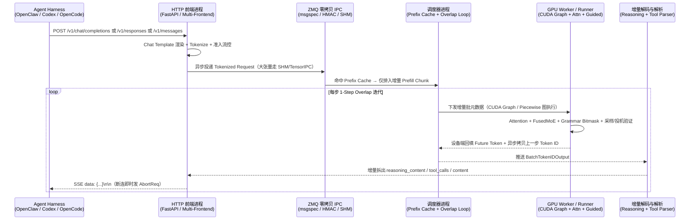

> [!FOCUS] 一条 Agent 请求穿透三家引擎的全景解剖
> 前三篇我们按模块拆解了物理模型、KV Cache 与调度加速栈。这一篇把所有模块重新组装起来：追踪**同一条多轮工具调用请求（携带长系统提示词、历史对话、`tools[]` 严格 Schema、流式思考与工具调用）**穿过 **vLLM V1**、**SGLang** 与 **TensorRT-LLM 1.4** 的真实进程边界与核心源码类，并给出面向不同 Agent 场景的选型决策矩阵。

---

## 1. 跨进程隔离的共同演进：为什么三家都用 ZMQ 拆开前端和 GPU？

在 Python 主导的推理引擎里，HTTP JSON 序列化、Chat Template 渲染、Tokenizer 编解码与 SSE 流式字符串拼接都会频繁争抢 **Python GIL**。一旦高并发 Agent 同时拉起上百条长流式 SSE 连接，单进程架构下 GPU 调度循环会被前端抖动拖得支离破碎。

因此 2026 年三家引擎**无一例外完成了“前端 API 进程 ↔ ZMQ IPC ↔ 独立调度/GPU 执行进程”的彻底隔离**：

---

## 2. 七段端到端生命周期源码级对照

对照三份 2026-11-24 主线源码实证基线（vLLM V1 `@ 9cd5cde`、SGLang `@ dacaf1d7`、TensorRT-LLM `1.4.0rc5 @ e627ac85`），七个核心环节的真实模块映射如下：

| 生命周期阶段 | vLLM V1 (`9cd5cde`) | SGLang (`dacaf1d7`) | TensorRT-LLM `1.4.0rc5` (`e627ac85`) |
|---|---|---|---|
| **① HTTP 协议面与多协议支持** | FastAPI `OpenAIServingChat` / `responses/api_router.py`；支持多 API Server 共享 `SharedAdmissionStats` 准入限流（超限返 503） | FastAPI + `ORJSONRoute`（支持 Uvicorn 多 worker / Granian / 可选 Rust 监听）；覆盖 Chat、Responses、**原生 Anthropic `/v1/messages`**、Ollama、Realtime | FastAPI + uvloop `OpenAIServer` + **`MultiFrontendServing`**（多前端共享底层 Executor）；覆盖 Chat、Responses、**原生 Anthropic `/v1/messages`** 与 Harmony |
| **② Tokenizer 与 IPC 边界** | P0 `AsyncLLM` + `InputProcessor` ↔ ZMQ `ROUTER/DEALER` + `msgspec` 零拷贝 + `TensorIPC` ↔ P1 `EngineCoreProc` | `TokenizerManager` ↔ ZMQ `PUSH/PULL`（多模态走 SHM；DP 经 `DataParallelController`）↔ `Scheduler` Rank 0 再广播 TP/CP | `LLM.generate_async` → `GenerationExecutorProxy` ↔ **HMAC 签名 ZMQ `IpcQueue`**（支持 MPI / RPC / Ray 编排与批合发）↔ `GenerationExecutorWorker` |
| **③ 调度器与批组织** | `Scheduler` / `AsyncScheduler`：对称 `token_budget` + 默认 Chunked Prefill + 纯重算抢占 | `Scheduler.event_loop_overlap`：Prefill 优先 + `LPM`（`bounded_lpm`）+ `FutureMap` 双流异步重叠 | `PyExecutor._executor_loop_overlap` + C++ `Capacity/MicroBatchScheduler` 或 `KVCacheV2Scheduler` + `beneficialToSkip()` + `AgentTree` |
| **④ ModelRunner 与图加速** | 模块化 V2 `GPUModelRunner`（UVA 持久化 `RequestState` / `BlockTables`）+ `VLLM_COMPILE` 分片 + **`FULL_AND_PIECEWISE`** CUDA Graph | `TpModelWorker` → `ModelRunner`：`decode_cuda_graph_runner`（Full/Breakable/Piecewise）+ `prefill_cuda_graph_runner` + TBO 双微批 | `ModelEngine`（**纯 PyTorch 后端，旧 `.engine` 后端已移除**）+ `torch.compile` + Decode/Breakable Prefill 图 + 旗舰模型芯片定制 **`modeling_v2`** |
| **⑤ Attention 与 KV 引擎** | `BlockPool`（O(1) 链式哈希 + HMA）+ `KVConnectorBase_V1`；FA2/3/4、FlashInfer、FlashMLA、Mamba | `UnifiedRadixCache` + `HiCache`（L1/L2/13 种 L3）；FlashInfer、FA3/4、FlashMLA、TRTLLM、DSA、KDA | C++ `KVCacheManager` V1/V2（32B SHA-256 `BlockRadixTree` + 四级 `StorageManager`）；`trtllm-gen`、FMHA、FlashMLA、FP4-MLA、CuTe-DSL MegaMoE |
| **⑥ 受约束解码与解析器** | `StructuredOutputManager`（与 GPU forward 并行填码 + `ConstraintBounds` 跳过思考）+ 新一代增量 **`ParserEngine`**（40+ 模型解析器） | `GrammarManager`（异步编译）+ `ReasonerGrammarBackend` + `FunctionCallParser`（40+ 检测器自动生成 `structural_tag`） | **`CapturableGuidedDecoder`**（`hostfunc` 嵌入 CUDA Graph + 投机回滚）+ `ThinkingBudgetLogitsProcessor` + 16+ Tool/Reasoning 解析器 |
| **⑦ Detokenize 与 SSE 推送** | P0 `OutputProcessor` 分片解码（命中 stop 立即 `abort_requests_async`）→ `ChatStreamProcessor` 推送 `text/event-stream` | 独立 **`DetokenizerManager`** 进程分组解码 + `msgspec.json.Encoder` 零拷贝拼 SSE；首块预跑校验，失败返 HTTP 400 而非假 200 | 可选独立 **`PostprocWorker` 多进程池**卸载解码/Tool/JSON 拼装 → FastAPI `StreamingResponse` + 断连异步监听即时取消后端请求 |

---

## 3. 三家架构设计哲学的本质差异

跳出具体类名，三家引擎实际上代表了三种截然不同的系统工程哲学：

1. **vLLM V1 — “极简内核 + 正交插件 + 硬件中立”**：
   - 把调度简化为单一 `token_budget`，把前缀缓存简化为 O(1) 块哈希，把抢占简化为纯重算，把多级卸载与 PD 分离全部收口到统一的 `KVConnectorBase_V1` 接口；
   - **最大红利**：新模型（DeepSeek-V4 / Qwen4 / Gemma4 / 混合 Mamba）与异构硬件（NVIDIA / AMD ROCm / XPU）适配速度全行业最快，团队上手与二次开发心智负担最低；
   - **主要权衡**：海量后端与连接器组合导致测试与调优配置面庞大，且跨节点缓存亲和需配合外部路由网关完成闭环。

2. **SGLang — “前缀树原语优先 + 全栈垂直一体化”**：
   - 从诞生起就围绕显式基数树（如今演进为 `UnifiedRadixCache`）构建整条技术栈：树感知 `LPM` 调度、按 TTFT 预算裁尾的 `TLRUStrategy`、原生 `HiCache` 逐层异步预取，以及仓内自带的 Rust `sgl-router` + `sgl-kv-indexer`；
   - **最大红利**：面对超高前缀复用、多分支探索和超大 MoE 集群（DeepSeek 系列 DP-Attention + DeepEP + TBO），从网关到 GPU 算子的整套闭环开箱即用、吞吐极高；
   - **主要权衡**：对路由层亲和强依赖（`sgl-kv-indexer` 当前为单点内存软状态）；通用主线已移除 FSM jump-forward，样板加速需搭配投机解码使用。

3. **TensorRT-LLM 1.4 — “PyTorch 敏捷外壳 + C++ 状态机内核 + NVIDIA 芯片极限”**：
   - 彻底告别过去“离线编引擎动辄半小时、改一行模型代码就重编”的沉重包袱，转向 `backend="pytorch"` 直接加载 HF 权重，同时把 KV 管理、调度、传输与专家均衡牢牢留在 C++（经 nanobind 零拷贝暴露），并在 Blackwell（SM100/103）/ Rubin（SM107）上压榨出 `trtllm-gen`、CuTe-DSL MegaMoE、NVFP4 与 `modeling_v2` 的芯片级极限；
   - **最大红利**：在最新代 NVIDIA 旗舰集群上往往具备最高性能上限；且在企业级多租户安全（SHA-256 防碰撞）、CUDA Graph 内受约束解码（`CapturableGuidedDecoder`）、子 Agent 亲和路由与原生 Anthropic `/v1/messages` 协议上极为完备；
   - **主要权衡**：深度绑定 NVIDIA 硬件生态；当前 `1.4.0rc5` 正处于 V1→V2 管理器与 `models/`→`modeling_v2/` 并行迁移期，配置项超过万行，调优与排障门槛最高。

---

## 4. 面向 Agent 工作负载的选型决策矩阵

没有绝对的“最强引擎”，选型应直接锚定你的 **Agent 流量形态、协议栈与硬件底座**：

| Agent 典型生产场景 | 首选引擎 | 次选 / 备选 | 核心决策依据 |
|---|---|---|---|
| **多轮长对话 + 多分支子 Agent 探索（高前缀共享）** | **SGLang** | TensorRT-LLM 1.4 | `UnifiedRadixCache` + `LPM` + `HiCache` 逐层回载 + Rust `sgl-router` 形成开箱闭环；TRT-LLM 的 `ConversationRouter`（含 `subagent_affinity_id`）与 `beneficialToSkip()` 同样极具竞争力 |
| **高频工具调用 + 强推理模型 + 严格 JSON Schema** | **三家均强（按硬件细选）** | 追求极限稳态选 TRT-LLM / 追求 40+ 开源模型即插即用选 vLLM V1 & SGLang | TRT-LLM `CapturableGuidedDecoder` 把语法约束嵌进 CUDA Graph 且内置 `ThinkingBudget`；vLLM V1 与 SGLang 覆盖 40+ 开源模型解析器并自带 Reasoning 门控与 `StructuralTag` |
| **Blackwell / GB200 NVL72 / Rubin 超大 MoE 集群** | **TensorRT-LLM 1.4** | SGLang | `trtllm-gen`、CuTe-DSL MegaMoE、NVFP4/FP4-MLA、MNNVL Wide-EP 与 `modeling_v2` 在 NVIDIA 最新代卡首发深度领先；SGLang 的 DP-Attention + DeepEP + TBO 也是主力选择 |
| **多云异构硬件（含 AMD ROCm）或紧追社区首发新模型** | **vLLM V1** | SGLang | vLLM V1 的硬件中立抽象、HMA 混合注意力与活跃社区使其对新架构与非 NVIDIA 算力的支持覆盖最广 |
| **强合规多租户企业 Agent 平台（防跨租户 KV 串数据）** | **TensorRT-LLM 1.4（V2）** | vLLM V1 / SGLang（需严配 `salt`） | TRT-LLM `KVCacheManagerV2` 原生强制 32 字节 SHA-256 链式哈希 + `ReuseScope(loraId, salt)` + 业务保留优先级 + `AgentTree` 流量配额治理 |
| **需要原生对接 Claude Code / Anthropic `/v1/messages` 协议** | **SGLang / TensorRT-LLM 1.4** | vLLM V1（经协议网关转换） | SGLang 与 TRT-LLM 1.4 均原生内建 `/v1/messages` 端点与流式块转换（协议差异参见 [Anthropic Messages 协议](#/llm-protocols/anthropic-messages)） |

> [!TIP] 给自建 Agent 推理底座的落地建议
> 无论选择哪一家引擎，**80% 的真实线上收益往往先来自“上下层对齐”而非抠单算子参数**：先把上层 [System Prompt 静动边界](#/system-prompts/engineering-principles) 切干净、把 [上下文压缩水位](#/codex/core/compaction) 控在有效窗口内、在多副本前架起 **Cache-Aware 路由**，再按需叠加 **投机解码（MTP/EAGLE3/SA）** 与 **PD 分离**，往往能用最小运维代价拿到成倍的延迟与成本改善。
