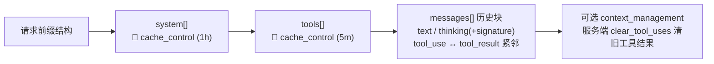

> [!FOCUS] 定位
> **`POST /v1/messages`** 是 Claude 全系原生协议（Claude Code 底座）。核心特色：**统一 Content Block 块数组（工具入参直接是 JSON 对象）+ 显式 `cache_control` 缓存断点 + 服务端 `clear_tool_uses` 工具清理**。

## 1. 请求与返回完整示例（同一天气查询场景）



### ① 第 1 轮请求（注意 `cache_control` 显式缓存断点与 `thinking` 开关）
```json
{
  "model": "claude-sonnet-4-6",
  "max_tokens": 4096,
  "thinking": { "type": "enabled", "budget_tokens": 2048 },
  "system": [
    {
      "type": "text",
      "text": "你是一个简洁的助手。",
      "cache_control": { "type": "ephemeral", "ttl": "1h" }
    }
  ],
  "tools": [
    {
      "name": "get_weather",
      "description": "查询指定城市天气",
      "input_schema": {
        "type": "object",
        "properties": { "city": { "type": "string" } },
        "required": ["city"]
      },
      "cache_control": { "type": "ephemeral" }
    }
  ],
  "messages": [
    { "role": "user", "content": "帮我查一下上海天气" }
  ]
}
```

### ② 模型返回（`content[]` 块数组：思考带防篡改签名，工具 `input` 直接是对象！）
```json
{
  "id": "msg_01XYZ",
  "role": "assistant",
  "stop_reason": "tool_use",
  "content": [
    {
      "type": "thinking",
      "thinking": "用户询问上海天气，应调用 get_weather 工具。",
      "signature": "EqoBCkYIAxgCKk..."
    },
    {
      "type": "tool_use",
      "id": "toolu_01ABC",
      "name": "get_weather",
      "input": { "city": "上海" }
    }
  ],
  "usage": {
    "input_tokens": 120,
    "cache_creation_input_tokens": 1500,
    "cache_read_input_tokens": 0,
    "output_tokens": 85
  }
}
```

### ③ 第 2 轮请求（`tool_result` 必须放在紧邻的下一条 `user` 消息开头）
```json
{
  "model": "claude-sonnet-4-6",
  "max_tokens": 4096,
  "messages": [
    { "role": "user", "content": "帮我查一下上海天气" },
    {
      "role": "assistant",
      "content": [
        { "type": "thinking", "thinking": "...", "signature": "EqoBCkYIAxgCKk..." },
        { "type": "tool_use", "id": "toolu_01ABC", "name": "get_weather", "input": { "city": "上海" } }
      ]
    },
    {
      "role": "user",
      "content": [
        {
          "type": "tool_result",
          "tool_use_id": "toolu_01ABC",
          "content": "{\"temp\":22,\"weather\":\"晴\"}"
        }
      ]
    }
  ]
}
```
> 这种“每条 `tool_use` 必须紧跟配对 `tool_result`”的硬约束，也是 [OpenClaw Steer 跳过串行工具时必须补齐合成配对结果](#/openclaw/agent-loop) 的底层协议原因之一。

### ④ 块级流式 SSE（按 `index` 区分不同 Content Block）
```text
event: content_block_start
data: {"type":"content_block_start","index":0,"content_block":{"type":"thinking","thinking":""}}

event: content_block_delta
data: {"type":"content_block_delta","index":0,"delta":{"type":"thinking_delta","thinking":"用户询问上海天气..."}}

event: content_block_start
data: {"type":"content_block_start","index":1,"content_block":{"type":"tool_use","id":"toolu_01ABC","name":"get_weather","input":{}}}

event: content_block_delta
data: {"type":"content_block_delta","index":1,"delta":{"type":"input_json_delta","partial_json":"{\"city\":\"上海\"}"}}

event: message_delta
data: {"type":"message_delta","delta":{"stop_reason":"tool_use"}}
```

---

## 2. 专为长程 Agent 设计的两项杀手锏

### ① 显式 `cache_control` 前缀缓存断点
- 开发者可把缓存断点精确打在 System Prompt、Tools 定义和历史节点上（支持 **5 分钟 / 1 小时** TTL），只要断点前字节不动，下轮 `cache_read_input_tokens` 直接命中缓存；
- 这也解释了为什么 [OpenClaw](#/openclaw/agent-loop/compaction) 坚持不随意修改早期图片、且等 Cache TTL 过期再做客户端修剪，以及 [Codex](#/codex/core/compaction) 坚持稳定前缀置顶 + `WorldState` 只发增量 Diff。

### ② 服务端工具结果清理（`context_management` · `clear_tool_uses`）
在请求中声明清理规则，服务端自动清掉早期冗长工具输出，而客户端本地历史完好无损——[OpenClaw Session Pruning](#/openclaw/agent-loop/compaction) 在 Anthropic 直连路由上直接委托的正是这个字段：

```json
{
  "context_management": {
    "edits": [
      {
        "type": "clear_tool_uses_20250919",
        "trigger": { "type": "input_tokens", "value": 50000 },
        "keep": { "type": "tool_uses", "value": 3 },
        "clear_at_least": { "type": "input_tokens", "value": 12500 }
      }
    ]
  }
}
```
