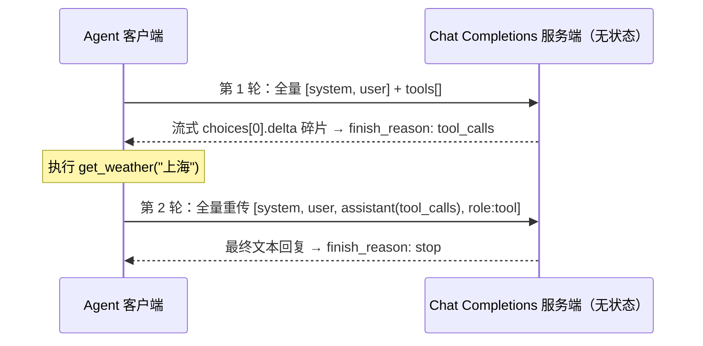

> [!FOCUS] 定位
> **`POST /v1/chat/completions`** 是全行业通用“最小公约数”（Ollama、vLLM、几乎所有开源和国产模型都兼容）。特点：**完全无状态、扁平消息数组、流式碎片拼接**。

## 1. 请求与返回完整示例（调用工具场景）



### ① 第 1 轮请求（客户端全量发送历史 + 工具定义）
```json
{
  "model": "gpt-4o",
  "messages": [
    { "role": "system", "content": "你是一个简洁的助手。" },
    { "role": "user", "content": "帮我查一下上海天气" }
  ],
  "tools": [
    {
      "type": "function",
      "function": {
        "name": "get_weather",
        "description": "查询指定城市天气",
        "parameters": {
          "type": "object",
          "properties": { "city": { "type": "string" } },
          "required": ["city"]
        }
      }
    }
  ]
}
```

### ② 模型返回（注意 `arguments` 是转义后的 JSON 字符串）
```json
{
  "id": "chatcmpl-123",
  "choices": [
    {
      "index": 0,
      "message": {
        "role": "assistant",
        "content": null,
        "tool_calls": [
          {
            "id": "call_abc1",
            "type": "function",
            "function": {
              "name": "get_weather",
              "arguments": "{\"city\":\"上海\"}"
            }
          }
        ]
      },
      "finish_reason": "tool_calls"
    }
  ]
}
```

### ③ 第 2 轮请求（必须把前面所有消息连同 `role: "tool"` 再次全量发回）
```json
{
  "model": "gpt-4o",
  "messages": [
    { "role": "system", "content": "你是一个简洁的助手。" },
    { "role": "user", "content": "帮我查一下上海天气" },
    {
      "role": "assistant",
      "content": null,
      "tool_calls": [{ "id": "call_abc1", "type": "function", "function": { "name": "get_weather", "arguments": "{\"city\":\"上海\"}" } }]
    },
    {
      "role": "tool",
      "tool_call_id": "call_abc1",
      "content": "{\"temp\":22,\"weather\":\"晴\"}"
    }
  ]
}
```

### ④ 流式 SSE 长什么样？（客户端需自行拼接参数碎片）
```text
data: {"choices":[{"delta":{"tool_calls":[{"index":0,"id":"call_abc1","function":{"name":"get_weather","arguments":""}}]}}]}
data: {"choices":[{"delta":{"tool_calls":[{"index":0,"function":{"arguments":"{\"city\":"}}]}}]}
data: {"choices":[{"delta":{"tool_calls":[{"index":0,"function":{"arguments":"\"上海\"}"}}]}}]}
data: {"choices":[{"delta":{},"finish_reason":"tool_calls"}]}
data: [DONE]
```

---

## 2. 对比新协议的 4 个核心短板

1. **无标准思考块**：推理模型的思考过程只能靠私有扩展字段（如 `reasoning_content`）硬塞，跨工具轮次缺乏统一续接规范；
2. **工具参数易截断损坏**：`arguments` 是流式 JSON 字符串，撞到 `finish_reason: "length"` 时容易留下半截非法 JSON（见 [OpenClaw Agent Loop](#/openclaw/agent-loop) 的截断恢复处理）；
3. **完全无状态、无服务端治理**：每轮必须全量重传历史，且没有服务端工具清理或压缩能力，瘦身全靠客户端（如 [OpenClaw 客户端修剪与摘要](#/openclaw/agent-loop/compaction)）；
4. **表达力偏扁平**：难以把思考、进度文本、多工具调用和压缩检查点作为平等的一等结构表达。
