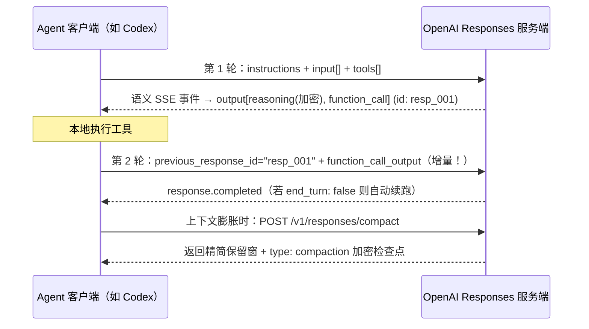

> [!FOCUS] 定位
> **`POST /v1/responses`** 是 OpenAI 面向长程 Agent 打造的新一代协议，也是 [Codex](#/codex/overview) 的核心推理底座。核心变化：**从扁平消息升级为类型化 Item 列表 + 语义流式事件 + 原生服务端状态与压缩**。

## 1. 请求与返回完整示例（同一天气查询场景）



### ① 第 1 轮请求（系统提示词独立为 `instructions`，工具结构更扁平）
```json
{
  "model": "gpt-5.4",
  "instructions": "你是一个简洁的助手。",
  "input": [
    { "role": "user", "content": "帮我查一下上海天气" }
  ],
  "tools": [
    {
      "type": "function",
      "name": "get_weather",
      "description": "查询指定城市天气",
      "parameters": {
        "type": "object",
        "properties": { "city": { "type": "string" } },
        "required": ["city"]
      }
    }
  ]
}
```

### ② 模型返回（`output[]` 是类型化 Item 列表：思考与工具调用是一等对象）
```json
{
  "id": "resp_001",
  "status": "completed",
  "output": [
    {
      "type": "reasoning",
      "id": "rs_01",
      "summary": [{ "type": "summary_text", "text": "需要调用天气工具查询上海。" }],
      "encrypted_content": "gAAAAAB..."
    },
    {
      "type": "function_call",
      "id": "fc_01",
      "call_id": "call_abc1",
      "name": "get_weather",
      "arguments": "{\"city\":\"上海\"}"
    }
  ]
}
```

### ③ 第 2 轮请求（支持 `previous_response_id` 增量续接，不必重传全量历史！）
```json
{
  "model": "gpt-5.4",
  "previous_response_id": "resp_001",
  "input": [
    {
      "type": "function_call_output",
      "call_id": "call_abc1",
      "output": "{\"temp\":22,\"weather\":\"晴\"}"
    }
  ]
}
```
> 注：若走无状态模式（不传 `previous_response_id`），则把上一轮的 `reasoning`（含 `encrypted_content`）和 `function_call` Item 原样放回 `input[]` 即可无损续接思维链。

### ④ 语义化流式 SSE（事件自带明确生命周期，无需猜状态）
```text
event: response.created
data: {"type":"response.created","response":{"id":"resp_001"}}

event: response.output_item.added
data: {"type":"response.output_item.added","item":{"type":"function_call","call_id":"call_abc1","name":"get_weather"}}

event: response.function_call_arguments.delta
data: {"type":"response.function_call_arguments.delta","delta":"{\"city\":\"上海\"}"}

event: response.output_item.done
data: {"type":"response.output_item.done","item":{"type":"function_call","status":"completed"}}

event: response.completed
data: {"type":"response.completed","response":{"id":"resp_001","status":"completed"}}
```

---

## 2. 专为长程 Agent 设计的两项杀手锏

### ① 服务端原生压缩（`POST /v1/responses/compact`）
当对话上下文膨胀时，客户端把历史送给服务端压缩端点，服务端返回一个**保留近期窗口 + 加密压缩检查点（`type: "compaction"`）**的精简数组：

```json
{
  "output": [
    { "type": "compaction", "encrypted_content": "gAAAAAB_compacted_state..." },
    { "role": "user", "content": "不要改数据库表结构，只修鉴权中间件。" }
  ]
}
```
- **[Codex 远端压缩 V2](#/codex/core/compaction)** 正是基于这套机制，叠出了**后台投机预压缩**（几乎零等待秒装）；
- **[OpenClaw](#/openclaw/agent-loop/compaction)** 在 OpenAI 直连路由上也消费了此端点，但做了压缩所有权保护（避免和自研 `ContextEngine` 打架，且在 Memory Flush 轮次禁用服务端压缩）。

### ② `end_turn: false` 显式续跑信号
即使某次 `response.completed` 里只有纯文本、没有工具调用，只要附带 `end_turn: false`，就代表模型“先汇报一下阶段进度，任务还没干完”，[OpenClaw Agent Loop](#/openclaw/agent-loop) 据此自动发起下一轮续跑而不会过早结束会话。
