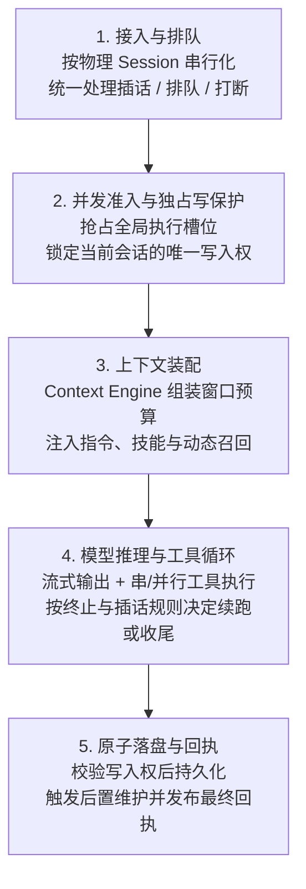

> [!FOCUS] 核心定位
> **Agent Loop** 是 OpenClaw 的单会话串行执行引擎，负责把一条输入消息转化为多轮推理、工具调用、流式输出与结果落盘；**Context Engine** 则是其中可插拔的上下文装配与压缩层。两者共同解决一个核心问题：**如何让长周期、多工具、可插话的 Agent 执行既不丢状态、又不失控**。

## 1. 一次 Turn 的核心执行架构

OpenClaw 把一次完整的 Agent 回合（Turn）拆分为清晰的分层管线，每一层只守一个核心职责：

### 为什么这样分层？三大架构设计思想
1. **单会话严格串行 + 写权限栅栏（防并发覆盖）**：
   - 同一个会话在同一时刻只允许一个“合法写入者”修改对话记录。即使发生超时重试、进程交接或异常抢占，过期执行流在提交落盘时也会被写栅栏拦截，避免旧结果覆盖新状态。
2. **等待时主动让出全局并发资源**：
   - 当一个会话在执行前需要做耗时的历史重建（Hydration）时，不会占着全局并发槽位干等，而是先释放并发配额、等重建完成后再重新排队，保证高并发场景下其他会话不被饿死。
3. **工具调用的结构化纠偏（防模型“嘴上调用”）**：
   - 有些模型容易把工具调用直接当纯文本/XML 输出出来。OpenClaw 绝不直接把文本当命令执行，而是隐藏影文本并要求模型通过原生工具接口重试一次，守住「文本展示」与「可执行动作」的边界。

---

## 2. 三层嵌套循环与回合终止机制

> [!FOCUS] 核心设计原则
> OpenClaw 的 Agent Loop 本质上是**三层由外向内嵌套的循环**（不是单一平铺死循环）。**“这轮会话是否可以结束”既不是大模型单方面说了算，也不是简单看“有没有工具调用”**，而是由三层循环各守其责、综合「模型意图」「工具交付事实」「队列防漏」三方信号共同裁决。

### 三层循环的职责与退出条件

| 循环层级 | 负责的问题 | 继续循环的条件（回边） | 退出条件 |
|---|---|---|---|
| **第 1 层（外循环）** Run 级收尾兜底循环 | 防止本轮即将结束的瞬间漏掉排队追问或刚到达的插话 | 退出第 2 层后，发现 FollowUp 队列有任务，或最终 Steer 复查命中新插话 | FollowUp 与最终 Steer **全部清空**，才正式宣告本轮 Run 结束 |
| **第 2 层（核心循环）** 推理 ↔ 工具 ↔ 插话主循环 | 驱动「输入注入 → 模型推理 → 工具结算 → 终止裁决」的多轮迭代 | 工具执行完毕且未提前终结；或模型显式声明还没说完；或检测到待处理 Steer | 无需续跑且无待处理 Steer（退到第 1 层复查）；或命中硬中止直接结束 |
| **第 3 层（工具内循环）** 单次回复的多工具调度 | 在模型一次回复包含多个工具调用时，协调执行顺序与插话截断 | 串行模式下仍有未执行的工具且无 Steer 等待；并行模式下等待整批全部完成 | 整批工具结算完成（或串行尾巴被 Steer 截断并补齐“已跳过”配对结果） |

### 六类终止与续跑场景的架构设计

| 场景 | 本质问题 | OpenClaw 的设计方案 |
|---|---|---|
| **1. 正常自然结束** | 模型给出最终答复且不再请求工具 | 退出内层循环，确认无排队插话或追问后正式收尾 |
| **2. 模型显式未说完** | 某些新协议（如 [OpenAI Responses 协议](#/llm-protocols/openai-responses)）允许模型先输出一段纯文本，同时标记“本轮尚未结束” | 运行时尊重协议级“未结束”信号，自动继续发下一轮推理，不会过早截断任务 |
| **3. 工具主动提前终结** | 如果 Agent 已经通过“发消息工具”把最终结果发给了用户，再把工具结果喂回模型往往会多跑一次无意义推理甚至重复回复 | 引入**工具终结协议**：一旦确认已向当前来源会话交付了最终回复（或主动挂起等待子任务），直接收尾不再多调一次模型；但**过程进度通知**或发往其他会话的消息不会触发终结 |
| **4. 主动静默 vs 空回复兜底** | 外部群聊里模型有时确实不需要说话；但更多时候“空输出/只输出了思考过程/撞到长度上限”是异常中断 | 区分**显式静默令牌**（主动表示不回复）与**异常空回复**；对异常空回复自动发起一次**无工具收尾轮**补全答复（若前置工具曾失败，强制如实报告失败而非谎称完成） |
| **5. 安全熔断与硬中止** | 模型陷入死循环反复调用同一个工具，或用户主动停止 | 设立**重复调用熔断器**与**取消信号优先通道**，命中后直接进入终态，不给模型继续空转的机会 |
| **6. 外部 Harness 适配** | 接入原生 Codex App-Server 等外部执行引擎时，谁拥有回合终止权？ | 尊重外部引擎原生生命周期（由其原生完成事件决定结束），不在外层用静默时长误判结束 |

---

## 3. Steer（运行中插话）与终止边界的协同

在默认模式下，用户不必等 Agent 跑完整个长任务才能纠偏，可以直接在执行中途发消息（**Steer**）。这一能力最容易引发三类工程事故：**破坏工具调用/结果配对、结束瞬间漏掉刚到的插话、把新问题吞进旧任务的完成态里**。

OpenClaw 用四条架构边界彻底化解了这些问题：

1. **安全边界截断，绝不野蛮中断**：
   - 模型刚吐出一批工具调用时，首个工具启动前不会提前取消；
   - **串行工具**：当前正在跑的工具完整跑完，随后**跳过后面尚未开始的串行尾巴**，并为每个被跳过的工具补齐一条“因处理新消息而跳过”的合成结果，保证对话历史的 `tool_call ↔ tool_result` 永远严格配对，再把用户插话交由模型重新规划；
   - **并行工具**：已同时发车的并行批次不会中途截断，等整批完成后统一在下一个模型边界注入插话；
   - 如果用户确实想直接叫停当前工作，则走独立的**显式打断通道**（如 UI 的“立即发送”仅中断可安全停止的前景工具，或直接停止整轮任务），**把“重定向未来计划”与“中止正在执行的工作”在语义上彻底分开**。

2. **退出前二次复查（防结束瞬间丢消息）**：
   - 当内层循环判定任务可以结束准备退出时，外层会先检查排队中的后续任务；如果为空，**在正式宣告结束前还会再做最后一次 Steer 复查**。只要在收尾瞬间刚好有新插话被接纳，立刻拉回执行循环，杜绝并发缝隙里消息被遗弃。

3. **插话打破既有“已完成”状态，保证每条输入都有交代**：
   - 一旦新的用户插话被正式接纳，运行时会重置之前的“工具已完成交付”标记——即使上一轮已经发过最终回复，新插话也必须得到属于它自己的独立答复，且按先进先出顺序分别交付，后一条不会覆盖前一条。

4. **清晰区分“执行中”与“收尾清理中”**：
   - 一旦本轮进入最终清理或所有权交接阶段，新到达的消息不再强塞进当前轮，而是安静转入下一轮队列；若模型请求失败正在重试，插话也不会劫持原请求的错误处理，保证故障恢复与新意图互不污染。

> [!TIP] 四种队列模式的本质取舍
> - **Steer（默认）**：在安全边界把新意图喂给当前轮，让模型顺势纠偏；
> - **Followup**：不打扰当前轮，等结束后按顺序开启新轮；
> - **Collect**：等当前轮结束后，把短时间内连发的多条兼容消息合并成一轮处理；
> - **Interrupt**：立刻中止当前任务，直接执行最新意图。

---

## 4. 双层 Hook 与可插拔 Context Engine

### 4.1 为什么设计双层 Hook？
OpenClaw 将扩展拦截分为两类，避免把控制面生命周期与模型推理细节混在一起：
- **控制面内部 Hook**：关注会话初始化与系统命令（如在构建系统提示词前动态增删引导文件，或响应新建/重置/停止会话）。
- **插件生命周期 Hook**：覆盖模型选择、提示词装配、工具调用前后、结果落盘前与消息收发全链路。其中安全拦截类钩子遵循**“拒绝即终态”**原则——一旦某个高优先级安全策略决定拦截某次工具调用或外发消息，后续低优先级插件无法把它翻盘改回放行。

### 4.2 可插拔 Context Engine：把“上下文策略”从主循环解耦
不同场景对长上下文的诉求完全不同（简单滑动摘要 vs 无损树状记忆 vs 跨会话检索）。OpenClaw 将上下文管理抽象为独立插槽，围绕五个标准生命周期解耦：

| 生命周期阶段 | 架构职责 |
|---|---|
| **Ingest（写入摄取）** | 新消息进入时同步落入引擎自有索引或结构 |
| **Assemble（窗口装配）** | 每次推理前在 token 预算内裁剪、排序历史，并可附带动态召回提示 |
| **Compact（压缩摘要）** | 上下文接近上限或手动触发时，对早期历史做压缩腾挪 |
| **After Turn（轮后沉淀）** | 每轮结束后持久化状态、异步触发后台索引或压缩 |
| **Maintain（后台维护）** | 可选的异步记录规整，放在后台执行以免拖慢用户回复延迟 |

> [!TIP] 两个非常巧妙的架构细节
> 1. **保住底层 Prompt Cache**：针对常驻 CLI 类执行后端，动态召回的上下文不直接改写主系统提示词，而是作为“当轮附加提示”附在用户输入旁，使主系统提示词保持字节级稳定，避免每轮都把模型缓存打失效。
> 2. **压缩所有权防打架**：当用户启用了接管压缩的自研 Context Engine 时，系统会自动关闭模型服务商侧的原生自动压缩，防止两端各自压缩把上下文改乱；并且在**记忆提取（Memory Flush）**阶段永远禁用服务端压缩，确保记忆系统看到的是未失真的原始上下文。
