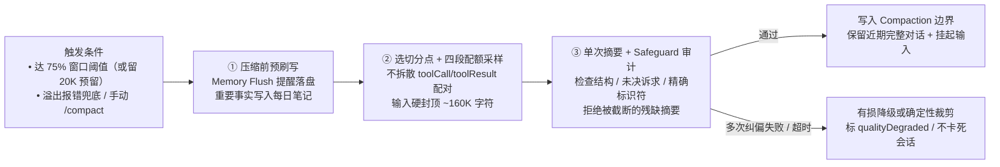

> [!FOCUS] 核心定位
> 与 Codex 深度绑定 OpenAI Responses 服务端不同，OpenClaw 需要同时兼容 **20+ 异构模型（Anthropic / OpenAI / Bedrock / Gemini / 本地模型）** 和 **7×24 长驻聊天会话**。因此它设计了一套**「先修剪工具输出（Pruning）→ 压缩前刷写记忆（Memory Flush）→ 有界配额摘要 + Safeguard 质量审计（Compaction）」**的三段式上下文治理体系，同时支持通过 `ContextEngine` 插槽整体替换。

---

## 1. 第一道防线：Session Pruning（老旧工具结果修剪）

长会话撑爆窗口的头号元凶往往不是聊天文本，而是动辄几万字的 `toolResult`（命令输出、大文件读取、搜索结果）。OpenClaw 在触发正式压缩前，先通过 **Session Pruning** 轻量瘦身——**只裁剪老旧工具结果，不动普通对话，且绝不改写磁盘上的原始历史**（仅维护可跨重启恢复的投影视图）：

- **Anthropic API 直连路由（服务端修剪）**：
  - 直接委托给 [Anthropic Messages 协议](#/llm-protocols/anthropic-messages) 的服务端工具清理能力（`clear_tool_uses`）；当输入超过阈值（`max(50K, 窗口 30%)`）时，保留最近 3 次工具结果，且要求单次至少能清掉 `max(12.5K, 窗口 5%)` 才动手——避免清得太少反而打废 Prompt Cache 得不偿失。
- **其他模型路由（客户端 `cache-ttl` 修剪）**：
  - **先等 Cache 过期再动刀**：只有当 Prompt Cache TTL 过期、且上下文占用超过 ~30% 时才启动新一轮修剪，不平白破坏热缓存；
  - **两级裁剪**：先做 **Soft-trim**（超 4,000 字符的工具结果只保留首尾各 1,500 字符）；若占用仍超 ~50% 且可裁剪内容够大，再做 **Hard-clear**（替换为 `[Old tool result content cleared]` 占位符）；
  - **两条硬保护红线**：**最近 3 轮助手回复永不修剪**；**首条用户消息之前的内容永不修剪**（保护 `SOUL.md` / `USER.md` 等启动引导）。

---

## 2. 第二道防线：Compaction（历史摘要压缩）

当会话真正逼近模型窗口上限，或遇到任意模型返回的上下文溢出报错时，OpenClaw 启动完整压缩：把早期历史浓缩为一条持久化摘要写入会话记录，**完整原始历史永远留在磁盘上供人工查看和按需检索**，压缩只改变下一轮喂给模型的视图。

### 2.1 触发时机与压缩前联动
- **主动触发阈值**：通用内建路径在「活跃窗口 **75%**」与「窗口减去 20K 预留」取较小值时自动触发（ChatGPT 登录 V2 路径为 90% 上限）；
- **溢出自动兜底**：识别 Anthropic、OpenAI、Bedrock、Gemini、Ollama 等几十种溢出报错，压缩后基于已结算工具结果续跑，**不重放已完成工具**；
- **手动聚焦压缩**：支持 `/compact Focus on API design decisions` 带聚焦指令手动压缩；
- **压缩前自动 Memory Flush**：触发压缩前先提醒 Agent 把尚未落盘的重要事实写入每日记忆笔记 `memory/YYYY-MM-DD.md`，防止压缩抹掉长期记忆。

### 2.2 四段配额采样（保证单次请求永不超限）
无论会话聊了多长，OpenClaw 内建摘要器都把喂给摘要模型的历史输入硬封顶在约 **160,000 字符（约 40K tokens，中文按 CJK 权重估算）**，超出时按固定优先级填满预算：
1. **50% 预算**：最新消息原样保留；
2. **25% 预算**：早期**用户消息**（承载核心诉求、决策与纠偏），均匀采样、每条上限 2,000 字符；
3. **10% 预算**：最早的消息（保留初始任务背景）；
4. **剩余预算**：中间对话均匀采样；每个跳过的空档明确标注“省略了 N 条消息”，严禁摘要模型凭空脑补；
5. **工具与媒体瘦身**：长工具结果只截取首尾（保住终端退出码与报错尾巴）；图片像素不进摘要模型，替换为极简占位标记；选切分点时**绝不从 `toolCall` 和 `toolResult` 中间切开**。

### 2.3 Safeguard 质量审计与防卡死兜底
OpenClaw 默认开启更严格的 **`safeguard`** 压缩模式：
- **拒绝残缺输出**：如果摘要模型撞到输出上限被截断，直接拒收，绝不把半截摘要写进会话；
- **结构化质量检查**：按 CJK 感知预算检查摘要是否保住了**结构、未决用户诉求与精确标识符（文件路径/ID）**，不合格则做有限次纠偏重试；
- **显式有损降级**：若确实放不下，按“先舍弃最长标识符 → 再放宽次要事实”有损降级，记录 `qualityDegraded` 并在界面警告建议 `/new` 或换更大模型；
- **超时确定性兜底**：自动压缩若因摘要模型超时失败，**绝不顺着模型回退链把用户拖死**，而是直接提交一次**无摘要确定性裁剪**（原样保留近期完整消息、工具对、挂起请求和上一份摘要），保证会话立刻恢复可用。

---

## 3. 横向对比：OpenClaw 压缩 vs Codex 压缩

| 对比维度 | OpenClaw 压缩 | Codex 压缩 |
|---|---|---|
| **适配对象** | 20+ 异构模型 + 长驻多渠道会话 | OpenAI Responses API 为主 + 专业长程 Coding |
| **前置瘦身** | 独立的 **Session Pruning**（按 Cache TTL 软/硬裁剪老旧工具输出） | 直接在压缩时做媒体预算裁剪与工具输出筛选 |
| **记忆联动** | 压缩前自动触发 **Memory Flush** 写入每日笔记 | 独立的线程记忆摘要（Thread Memory） |
| **核心加速/质量手段** | **四段配额采样** + **Safeguard 质量审计** + 超时确定性裁剪 | 基于 [Responses 协议](#/llm-protocols/openai-responses) 的 **[远端压缩 V2 + 后台投机预压缩](#/codex/core/compaction)**（零等待秒装） |
| **环境状态更新** | 保留引导文件与每轮热刷新 `MEMORY.md` / `USER.md` | 压缩时弃旧增量，**全量重算最新 `WorldState` 基线** |
| **可扩展性** | 支持 `ContextEngine` 插件插槽整体替换（如无损树状压缩） | 内建三条固定路线（远端 V2 / 本地摘要 / 预算开新窗） |
