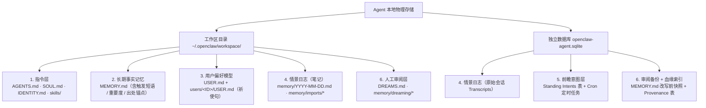

> [!NOTE] 本页聚焦
> 回答两个核心问题：**OpenClaw 里一共有哪六类记忆？每一类具体存在哪儿、包含哪些文件、内容是怎么编排组织的？**

## 1. 指令层（Instructions）—— Agent 的“宪法与岗位手册”

- **存在哪儿**：Agent 工作区根目录（默认 `~/.openclaw/workspace/`，多 Agent 时为 `~/.openclaw/workspace-<agentId>/`）。
- **具体包含哪些指令文件**：
  - **`AGENTS.md`（核心操作手册）**：定义工作规程、优先级、记忆使用方式以及本地工具约定。每次会话启动必加载，连派生的轻量子会话也会加载它。
  - **`SOUL.md`（人格与语气）**：定义性格、表达风格与行为底线，每次主会话启动加载。
  - **`IDENTITY.md`（身份标识）**：记录 Agent 的名称、气质与图标等基础身份。
  - **`BOOT.md`（可选启动清单）**：Gateway 重启时执行的一次性自检清单。
  - **`BOOTSTRAP.md`（一次性初始化仪式）**：仅在全新工作区首次创建时存在，初始化完成后即删除。
  - **`skills/`**：当前工作区专属技能目录，同名时优先级高于全局与内置技能。

---

## 2. 长期事实记忆（Curated Core）—— 精炼的跨会话知识底座

- **存在哪儿**：工作区根目录下的单个精选文件 **`MEMORY.md`**（仅在私人主会话自动加载，不向多人共享群聊泄露）。
- **怎么编排、存什么**：
  - 只存**经反复验证的稳定事实、长期架构决策、环境约定与短摘要**——绝不是原始对话归档，也不是每日流水账。
  - 每条记录保持精炼，行尾可附带三类轻量结构化元信息：
    - **触发短语**：说明这条事实在什么话题下相关，供后续自动精准注入；
    - **重要度（1–10）**：写入时一次性评定，用于检索排序；
    - **仓库标识与出处锚点**：标明所属 Git 仓库（防多仓库串台）及源自哪天每日笔记的哪几行，方便人类核查。

---

## 3. 用户偏好模型（User Model）—— 独立的“人”的模型

- **存在哪儿**：
  - 单人模式：工作区根目录的 **`USER.md`**；
  - 多人共享 Gateway：根目录 `USER.md` 存放**共享默认偏好**，每个已登录自然人另有独立文件 **`users/<个人ID>/USER.md`**。加载时先读共享默认、再叠加当前会话归属人的个人文件（个人偏好可覆盖共享默认，但**不能**覆盖项目硬规则与安全策略）。
- **怎么编排、存什么**：
  - 存放**稳定偏好、沟通风格、人际关系与当前关注项目**，单独享有 4,000 字符启动预算。
  - **格式铁律**：全部写成**当前有效的祈使句指令**（如“总是…… / 绝不…… / 优先……”），**不写“某年某月用户曾说过……”的叙述体**——因为叙述体偏好在几轮对话后极易被模型忽略，只有直白祈使指令才能稳定生效。

---

## 4. 情景日志层（Episodic）—— 按天沉淀的原始素材池

- **存在哪儿**：由三部分构成——
  1. **每日工作笔记**：工作区下的 **`memory/YYYY-MM-DD.md`**（以及带主题后缀的同日变体 `memory/YYYY-MM-DD-<slug>.md`）；
  2. **完整会话记录（Transcripts）**：存储在 Agent 专属 SQLite 数据库中；
  3. **外部导入归档**（可选）：从 Codex、Claude Code、Hermes 导入的记忆独立存放在 `memory/imports/<工具名>/`，只供按需检索，不直接混入 `MEMORY.md`。
- **存什么**：体量大、追加友好的过程观察、调试细节、会议要点与原始对话，作为长期记忆的原始素材池。

---

## 5. 前瞻意图层（Prospective）—— “以后某个时机要做某事”

前瞻记忆最容易随上下文变长而彻底遗忘，因此 OpenClaw **不把它塞进普通记忆段落**，而是按触发方式拆成三种载体：

| 意图类型 | 典型例子 | 存放载体 |
|---|---|---|
| **时间触发型** | “周五上午 9 点提醒我发版” | 直接编译为 **Cron 定时任务** |
| **事件触发型** | “以后有人提到发版时，提醒我核对回滚负责人” | 存入 Agent 专属 SQLite 表的**常驻意图（Standing Intents）** |
| **长期愿景型** | “本季度优化发布清单” | 无法编译为机器条件，带审阅日期留在 Markdown 中 |

---

## 6. 人工审阅层（Review）—— 记忆变更的审计账本

- **存在哪儿**：工作区下的 **`DREAMS.md`**（梦境日记）、可选分阶段报告 `memory/dreaming/<阶段>/YYYY-MM-DD.md`，以及 SQLite 中每次 `MEMORY.md` 改写前的完整快照。
- **存什么**：记录后台整理新增、合并、覆盖了哪些事实，以及哪些候选被拒绝；**永不注入模型上下文**，也不作为二次学习素材，专供人类核对与回滚。
