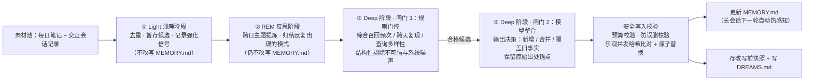

> [!NOTE] 本页聚焦
> 回答三个核心问题：**记忆是每天存还是每月存？新事实/新偏好来了，老记录变不变？不需要或污染的记忆怎么删除？**

## 1. 各类记忆的更新节奏与冲突策略总表

| 记忆类型 | 写入频率 / 触发时机 | 新内容来了，老记录变不变？ | 如何删除 / 撤销 |
|---|---|---|---|
| **指令层** | 仅人工按需编辑 | 人工直接改写 | 人工直接编辑或删除文件 |
| **情景日志层** | **按天建文件（每天一份）**：对话随时追加 + 长会话压缩前预刷写 + 短会话结束后增量采集 | 纯追加为主，保留原始时间线 | 可设准入规则排除采集；“遗忘会话”清索引但不自动删原始对话 |
| **长期事实记忆** | **显式要求即时写 + 默认每日后台 Dreaming 定时提炼**（不是每句都写，也不是按月写） | **会变**：重复事实合并去重；变更事实按替代键**覆盖淘汰旧事实** | 人工直接删行；或按会话血缘整条遗忘清理 |
| **用户偏好模型** | 用户在编辑器或授权对话中显式触发 | **原地覆盖替换**，绝不保留互相矛盾的旧偏好（历史变迁只留每日笔记） | 人工直接编辑删除 |
| **前瞻意图层** | 说出瞬间即编译落库（仅授权主人可建事件意图） | 状态机自动推进：`待武装 → 已武装 → 冷却 → 耗尽/过期` | **必须人工显式下令取消**，绝不靠模型从闲聊猜测 |
| **人工审阅层** | 每次后台 Dreaming 完成后自动追加 | 追加审计日志，并保留改写前快照 | 人工清理归档 |

---

## 2. 情景日志为什么有“压缩前预刷写”？

不同用户的使用习惯差异极大：
- **长会话用户**：一个会话聊一整天，快撞到上下文窗口上限时会触发历史摘要压缩。压缩前系统会先发起一次**防遗忘预刷写（Pre-compaction Flush）**，把尚未落盘的关键事实补写进当天 `memory/YYYY-MM-DD.md`，防止压缩把细节抹平。
- **短会话用户**：每天开十几个短会话。每个会话结束后，后台通过约 5 秒合并窗口增量索引原始记录。

两条路径最终把所有素材汇流到同一个情景层，等待后台整理。

---

## 3. 长期事实的后台更新：Dreaming 三阶段整合

`MEMORY.md` 只有一条主自动写入通道——默认开启的后台 **Dreaming** 流水线，按顺序走完三个阶段：

### 新旧事实冲突与安全写入的 4 个关键机制
1. **靠“反复有用”晋升，而非靠“写得笃定”**：规则门控重点看召回频次、跨天复现度与不同问法的多样性，自然淘汰一次性闲聊。
2. **合并与覆盖淘汰（老事实确实会变）**：模型面对新旧事实时输出结构化编辑决策——重复的合并去重（并将多个来源血缘归并到幸存条目）；过时的（如换了部署服务器）通过**替代键（Supersession Key）**直接覆盖淘汰。
3. **防误删与超预算降级**：改写前强制校验“旧条目丢失比例不超上限、总大小不超启动预算”。若不通过则拒绝整篇覆盖，降级为安全追加或保持原文件不变；若文件本身已超预算，磁盘原文件不动，仅在注入上下文时截断提醒。
4. **乐观并发防人工编辑冲突**：不锁明文文件，而在原子替换前重新核对内容哈希——如果后台整理期间你正好手动改过 `MEMORY.md`，系统立刻放弃覆盖并安全降级，绝不覆盖你的手写修改；且一旦更新成功，**已打开的长会话在下一轮就会自动加载新版本，无需重启**。

---

## 4. 前瞻意图的生命周期与显式取消

事件型常驻意图由严格的状态机和防骚扰上限保护：
- **状态流转**：`pending（待武装）→ armed（已武装）→ fired（已触发、冷却中）→ done（次数耗尽）/ expired（过期）/ cancelled（显式取消）`。
- **防骚扰默认硬限**：冷却 **24 小时**、最多触发 **3 次**、**90 天**自动过期、单轮最多注入 3 条。
- **为什么取消必须显式下令？** 评测表明主动提醒系统极易误判事件取消，因此 OpenClaw 把“取消”做成持久化状态变更，绝不让模型从普通对话里自行猜测取消。

---

## 5. 如何彻底删除某次会话衍生的记忆？

如果某次敏感会话或错误讨论已经进入了记忆体系：
- 系统在 SQLite 中为自动采集和晋升的条目记录了**来源会话血缘**（即便经过合并或覆盖，父条目的来源血缘也会一并继承到幸存条目上）；
- 执行**按会话遗忘（`memory forget`）**时，可先预览受影响的索引与 `MEMORY.md` 条目，确认后整条清除，并把该会话永久标记为“已遗忘”，防止后续后台整理再次把它采集回来；
- **边界提醒**：手工自由改写且未带血缘标记的段落，以及原始聊天记录本身，不会随“遗忘会话”自动删除，需要按需单独审阅清理。
