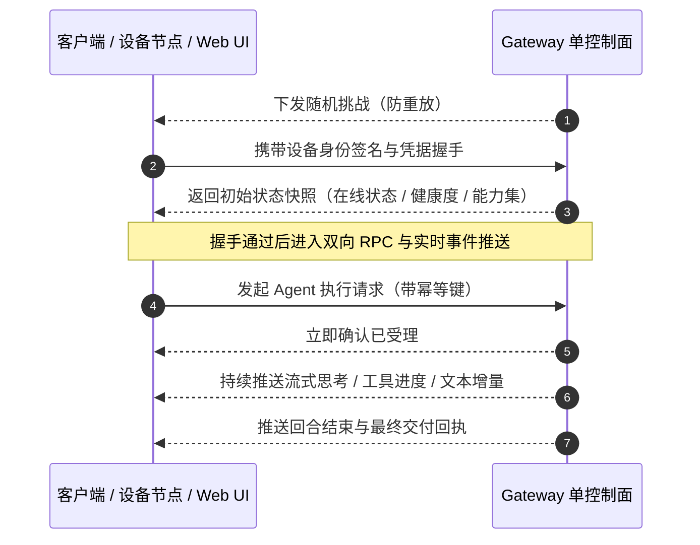

> [!NOTE] 分析基准
> 本文基于 [openclaw/openclaw](https://github.com/openclaw/openclaw)（MIT 协议，OpenClaw Foundation 维护）整理，聚焦整体架构设计原理与核心边界取舍。

## 1. OpenClaw 的本质定位与三大主张

OpenClaw 不是单一渠道的聊天机器人，也不是绑定某家模型的 Agent 套壳，而是一个**运行在用户自有硬件上的多渠道 AI 控制面（Local Control Plane）**。

它的整体设计由三条核心架构主张驱动：
1. **单控制面统一收口**：一个长驻的 Gateway 进程同时接管 WhatsApp、Telegram、Slack、Discord、iMessage、Teams、WebChat 等 20+ 消息入口，以及 CLI、Web 控制台和移动端/桌面端原生节点。
2. **数据与执行主权本地化**：会话历史、长期记忆和凭据全部留在用户自有设备上；底层大模型和执行引擎（Claude、Codex、本地模型等）全部抽象为可热替换的插件，换模型不换体系。
3. **可信控制面 + 不可信执行域**：核心理念是 **Trusted Gateway, Untrusted Execution, Policy Enforced by Code**——把一切外部消息视为不可信输入，安全与权限靠控制面代码硬约束，而不是靠提示词祈祷模型自觉。

## 2. 为什么采用「单机单 Gateway」控制面架构？

很多 Agent 框架把每个聊天渠道或每次 CLI 调用做成独立进程，结果很快就会遇到状态撕裂、会话抢占和策略不一致的问题。OpenClaw 选择**单机单 Gateway 独占控制面**：

- **独占外部渠道长连接**：例如 WhatsApp 这类单点登录协议，只能由唯一的控制面持有连接，避免多进程互踢。
- **统一状态与事件广播**：Web UI、CLI、桌面端与移动设备都作为客户端连入同一个 Gateway，天然共享同一份会话视图、在线状态与健康快照。
- **设备节点也是标准客户端**：手机、电脑等伴生应用以“设备节点（Node）”身份接入同一条 WebSocket 通道，把摄像头、录屏、定位、画布等本地硬件能力声明为可调用命令，使控制面无需为不同终端造多套协议。

## 3. 通信协议与控制面不变量

为了支撑多端并发接入、弱网重连和跨语言客户端（TypeScript / Swift 等），Gateway 协议守住四条核心不变量：

1. **首帧强制握手**：连接建立后的第一帧必须是合法的身份握手，否则直接硬断开，把未认证流量挡在最外层。
2. **有副作用操作强制幂等**：发消息、触发 Agent 执行等操作必须携带幂等键，控制面维护短期去重缓存，防止弱网重试导致重复回复或重复执行。
3. **实时事件不做历史重放**：推送给客户端的流式事件只负责实时同步；如果客户端断线发现序号断层，直接主动拉取最新快照纠偏，大幅降低服务端内存与状态同步复杂度。
4. **单一协议真源驱动跨语言一致**：协议结构从一份类型定义出发，自动派生服务端入站校验规则与原生客户端模型，避免多端联调时字段漂移。

## 4. 后台调度与优雅关停设计

一个常驻控制面除了响应实时对话，还要承载定时任务（Cron）、心跳巡检、记忆整理和插件后台服务。OpenClaw 把这些定时工作收敛到一个**统一的内核调度器**：

- **同时感知墙上时间与单调耗时**：笔记本合盖休眠后醒来，墙上时间能立刻发现错过触发点并合并补跑一次（不会把休眠期间错过的几十次任务瞬间雪崩重放）；单调时钟则防止系统校时向后跳变把定时任务卡死。
- **两段式优雅关停**：退出时先关闭新任务准入、取消尚未触发的等待任务，再在有界时间内等待正在运行的回调与子作用域自然收敛，避免强杀导致数据库或外部连接处于半残状态。

## 5. 模块分层与扩展边界

整个系统按“稳定内核 + 共享契约 + 海量可插拔扩展”三层解耦：
- **核心控制面**：只保留 Gateway、会话路由、Agent 执行循环、记忆宿主、安全策略与调度器等稳定底座；
- **跨端共享契约**：把协议、上下文引擎、工具修复、网络策略等抽象为独立包，供核心与插件共同消费；
- **外围生态扩展（约 200 个官方扩展）**：几乎所有具体模型服务商、消息渠道、浏览器控制、外部协议桥接都落在外围扩展层，确保核心架构不会因为接入新模型或新 IM 而膨胀变形。
