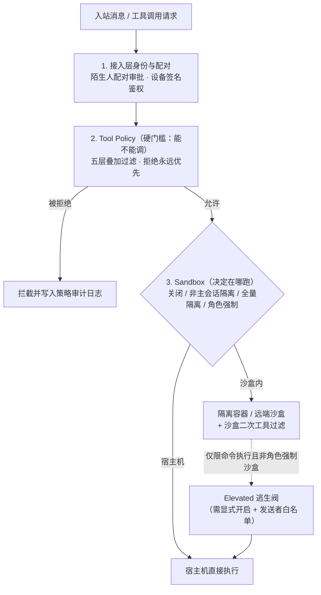

> [!NOTE] 本页聚焦
> 沙箱解决的是“工具在哪跑”，本页聚焦另外两道防线：**Tool Policy（哪些工具能调）**、**Elevated（宿主机逃生阀边界）**，以及入口层的**配对与设备强认证**。

## 1. 三道防线的协作关系

## 2. Tool Policy 五层叠加与两个经典误区

工具可用性并非一刀切，而是从粗到细经过**五层叠加收敛**（且**拒绝规则永远压过允许规则**）：
**全局基础模板 → 服务商/具体模型模板 → 全局/单 Agent 允许拒绝表 → 服务商精细策略 → 沙盒内二次策略**。

> [!WARNING] 两个最容易踩坑的安全认知误区
> 1. **“禁掉文件写入工具 ≠ 只读 Agent”**：工具策略只按工具名称做过滤，不审查 Shell 命令内部干了什么。如果同时放行了命令执行工具（`exec`），模型依然可以通过命令行改写文件。真正的只读约束必须**同时禁用命令执行工具**，或依靠**沙箱只读挂载（`ro`）**在操作系统层兜底。
> 2. **“沙盒内 MCP / 插件工具必须过第二道闸门”**：原生插件与 MCP 服务运行在 Gateway 宿主机侧；当会话运行在沙箱中时，它们不仅要通过全局工具策略，还必须显式通过**沙盒工具策略**这第二道白名单，防止高危宿主机能力在不知情的情况下暴露进隔离环境（更多 MCP 威胁模型详见 [MCP 生产治理与安全防线](#/agent-protocols/mcp-governance-and-security)）。

## 3. Elevated（宿主机逃生阀）的严格边界

Elevated 仅用于“平时在普通沙箱里跑，偶尔需要某条命令临时到宿主机跑”的场景，有三条硬边界：
1. **只作用于命令执行（`exec`）**，绝不会赋予模型原本没有的其他工具；
2. **无法推翻 Tool Policy 的拒绝**：如果 `exec` 本身已被禁止，提权开关完全无效；
3. **无法绕过“角色强制沙盒”**：若会话创建者的角色要求强制沙盒，任何提权开关或管理员会话级豁免都会被直接拒绝。

## 4. 入口层纵深防御：陌生人配对与设备强认证

- **默认拒绝陌生私聊（DM Pairing）**：支持私聊的渠道默认不对陌生人开放，未知发送者必须经管理员显式配对审批后才能触发 Agent，防止公网机器人被路人白嫖或注入攻击。
- **跨设备挑战签名认证**：所有连入控制面的客户端与设备节点，连接时都必须用设备私钥对服务端随机挑战签名，并绑定平台与设备类型；除本机回环直连外，哪怕是局域网或私有组网（Tailnet）接入，也都要求显式设备配对审批。
