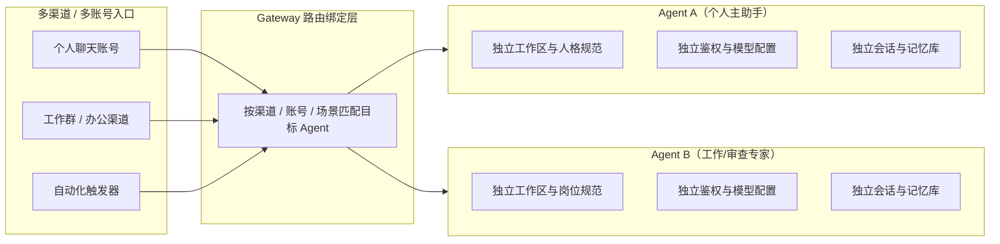

> [!FOCUS] 核心设计思想
> OpenClaw 把“聊天的入口”和“思考的主体”彻底解耦：**所有会话状态归 Gateway 独占管理**，外部消息通过路由规则映射到具体会话；而**多 Agent 隔离**则通过物理工作区、独立身份凭据与独立数据库的“三件套隔离”实现，保证不同角色互不串台。

## 1. 消息路由原理：不同入口如何归属会话？

个人助手最核心的体验矛盾在于：**私聊希望跨平台连续，而群聊和后台任务必须严格隔离**。OpenClaw 为不同消息来源设计了差异化的默认路由边界：

| 消息来源 | 默认会话策略 | 设计意图 |
|---|---|---|
| **私聊（DM）** | 默认汇入同一个主会话 | 单人使用时，无论在微信/WhatsApp/Telegram 还是网页端对话，上下文天然连贯 |
| **群聊与频道** | 按群 / 按频道独立隔离 | 不同群的讨论互不干扰，避免把 A 群信息泄漏到 B 群 |
| **定时任务（Cron）** | 每次触发新建独立会话 | 后台巡检不污染日常主对话上下文 |
| **外部 Webhook** | 按触发源独立隔离 | 自动化事件与人工聊天边界清晰 |

### 多人共享时的隐私隔离设计
> [!WARNING] 架构级隔离提醒
> “所有私聊共享主会话”的前提是**单人自用**。一旦允许多个不同的人给同一个助手发私聊，必须切换为**按发送者或按“渠道 + 发送者”隔离**的会话作用域，否则不同用户的私密对话会混在同一个上下文里造成越权泄密。
>
> 反过来，如果**同一个人**习惯跨多个平台联系助手，则可通过**跨渠道身份映射**把其多个平台账号归并到同一逻辑主体，在安全隔离他人的同时保留个人跨端连续性。

## 2. 多 Agent 硬隔离模型：什么是“一个 Agent”？

单个 Gateway 进程可以同时托管多个完全独立的 Agent——它们既可以是不同的人格/服务对象，也可以是分工明确的不同岗位（例如日常主助手、代码审查员、依赖巡检员）。

每个 Agent 物理独占三样东西：
1. **独立工作区（Workspace）**：存放该 Agent 的行为规范、人格设定、本地笔记与工作文件。
2. **独立身份与凭据空间**：各自的模型授权与配置互不混用，避免多个 Agent 争抢或覆盖同一份 OAuth 会话状态。
3. **独立会话数据库**：每个 Agent 拥有独立的持久化存储，历史记录与检索天然隔离。

> [!NOTE] 工作区边界 vs 沙盒边界
> Agent 的工作区只是执行时的**默认工作目录**，并不等于安全沙盒。如果没有开启沙盒隔离，具备文件或命令执行能力的 Agent 依然可以通过绝对路径触达宿主机其他目录——**目录归属解决的是“组织隔离”，安全隔离必须交给沙盒层**。

## 3. 创建者归属与受控多 Agent 协作

在真实团队或多任务场景下，Agent 往往需要派生子任务或协同工作。OpenClaw 对此设计了两项关键的治理机制：

### 3.1 创建者（Creator）与执行负责人（Owner）分离
- 任何被委派出去的子会话或自动化任务，都会永久记录**最初发起该工作的已验证人类创建者**。
- 即使后续任务被重新指派给其他负责人，涉及对外公开链接、共享授权、归档与恢复等高敏权限，依然受原创建者与管理员策略约束，防止权限在委派链条中悄悄漂移。

### 3.2 有界团队协作（总控 + 专家模式）
OpenClaw 不鼓励无约束的“多 Agent 自由群聊”（极易陷入死循环与 token 爆炸），而是推崇**有向、有界的层次协作**：
- **总控角色（Coordinator）**作为面向人类的唯一接口，负责拆解问题、挑选合适的专家 Agent 派发有界任务、验收产出并汇总交付；
- **专家角色（Researcher / Writer / Reviewer 等）**被策略禁止继续向外派生子 Agent，只负责交付结果与证据，天然切断无限递归委派的风险；
- 专家的操作规程写在核心指令文件中，确保即使在轻量级派生子会话里也能稳定生效，不依赖完整人格加载。

## 4. 会话归档与存储韧性
- **无临时明文落盘的流式读取**：历史会话压缩归档后，查询、统计与记忆索引都直接流式解压读取所需字节区间，既不向临时目录释放明文副本（防敏感信息残留），又强制解压体积上限（防压缩炸弹拖垮宿主机）。
- **零阻塞后台命名**：新会话在进入处理的同时并行异步生成主题标题，绝不阻塞首字响应；手动修改过的标题永远优先保留。
