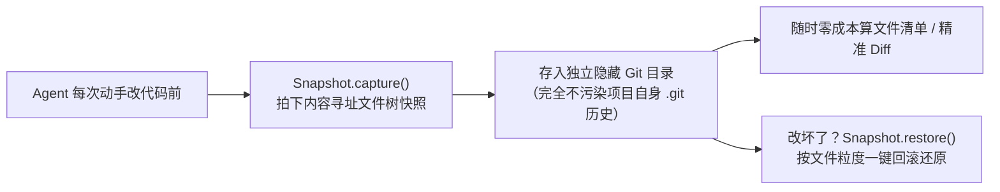

> [!FOCUS] 安全哲学的本质差异
> 与 [OpenClaw（默认 Docker 容器沙箱）](#/openclaw/security/sandbox-backends) 和 [Codex（三端 OS 原生进程沙箱）](#/codex/security-and-approval) 不同，OpenCode 默认**不内置操作系统级沙箱**，而是选择了另一条面向个人开发者的高效路线：**「角色分离 + 声明式通配符权限规则引擎 + 隐藏 Git 快照一键时光倒流」**。

---

## 1. 内置多 Agent 角色分工

OpenCode 默认内置两个主 Agent（终端里按 `Tab` 一键切换）加一个内部子 Agent：
- **`build`（默认开发模式）**：拥有完整读写与命令执行权限，面向日常功能开发与修复；
- **`plan`（只读规划模式）**：默认**拒绝所有文件修改**、运行 Bash 命令前强制询问，专门用于探索陌生代码库和评审改动方案；
- **`@general`（通用子 Agent）**：用于复杂跨文件检索与多步隔离任务，支持按最大嵌套深度（Subagent Depth）控制防无限递归，完成后将结果回投主会话收件箱。

---

## 2. 声明式通配符权限引擎（`allow` / `ask` / `deny`）

OpenCode 的权限层把一切敏感操作（`read`、`edit`、`external_directory`、`bash` 等）抽象为 `(action, resource) → effect` 的规则链评估（后命中覆盖前命中，未命中默认 `ask`），包含四个非常实用的工程细节：

1. **跨机器权限硬隔离**：在多机/远端工作场景下，**本机保存的 `allow *` 规则绝不会自动放行另一台远端机器上的文件**——必须显式命名目标机器才能放行，而 `deny` 和 `ask` 规则则全局生效；
2. **macOS 大小写不敏感防绕过**：在 macOS 上 `.OPENCODE/x` 与 `.opencode/x` 指向同一文件，路径权限匹配会自动开启大小写不敏感校验，堵住靠大小写变体绕过黑名单的漏洞；
3. **无人值守模式（Unattended）自动收敛**：后台定时任务或自动化流程在无人可点“同意”时，系统将原本需要 `ask` 的请求自动收敛为 `deny`（配置里的 `deny` 永远最先裁决），绝不卡死也绝不静默放行；
4. **拒绝即纠偏（`CorrectedError`）**：当用户拒绝某次工具调用时，可以附带一句反馈原因直接以错误结果喂回给模型，引导模型立刻换方案继续，而不必中止整轮对话。

---

## 3. 隐藏 Git 快照时光机（Snapshot）与 Worktree

既然没有强沙箱拦截一切写入，那如果模型改坏了十几个文件怎么办？OpenCode 给出了非常漂亮的工程解法——**独立隐藏 Git 快照（`Snapshot`）**：

- **绝不污染项目自己的 `.git`**：快照仓库存放在全局数据目录中，不会给你的仓库多出垃圾 commit 或污染暂存区；
- **真实路径防软链越界**：捕获前先解析工作区真实物理路径，校验目标目录确实在项目树内，防止软链把项目外文件卷入快照；
- **后台自动打包（`objects.pack`）**：定时异步压缩快照对象（带跨进程锁防并发冲突），控制长期磁盘占用；
- 同时支持 **Git Worktree** 隔离并行任务。

> [!WARNING] 边界对比提醒（结合 [AI Agent 沙箱技术全景](#/agent-sandbox/overview)）
> 隐藏 Git 快照能完美解决“**改坏项目代码后一键撤回**”，但它属于**事后可恢复（Undo）**，**不能替代事前隔离（Sandbox）**——如果执行了恶意 Shell 命令去读取 `~/.ssh` 或外传环境变量，快照无法撤销已经发生的外泄。因此在面对不可信仓库或多人场景时，仍需配合 [OS 进程级沙箱](#/agent-sandbox/process-and-runtime) 或 [容器/云端沙箱](#/agent-sandbox/container-and-gvisor) 使用。
