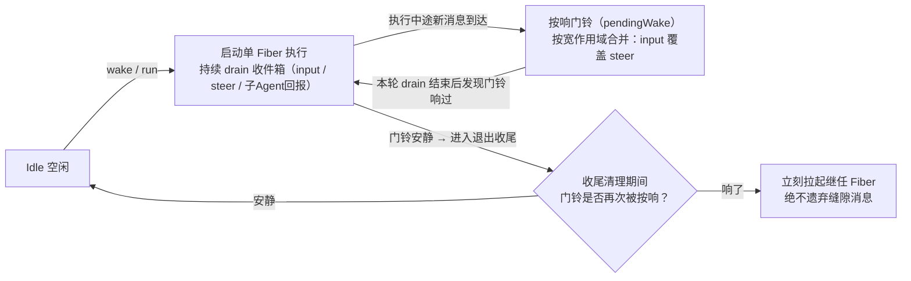

> [!FOCUS] 核心亮点
> OpenCode 在执行循环与上下文压缩上吸收了大量现代工程经验：用**「单 Fiber 门铃模型（Doorbell）」**优雅消灭并发漏消息竞态，用**「Write-Ahead Claim 预写认领」**把崩溃恢复做成数据库固有属性，并在压缩上同时实现了**后台预计算**与**四级渐进降采样**。

---

## 1. 执行循环：单 Fiber 门铃协调器（Doorbell Pattern）

与 [OpenClaw 三层循环 + 退出前二次复查](#/openclaw/agent-loop) 解决的是同一个本质问题——**如何保证单个 Session 严格串行，同时在“刚刚决定结束”的并发缝隙里绝不漏掉新来的用户消息或插话（Steer）？**

OpenCode 用一套非常干净的**门铃状态机**解决：

- **宽作用域合并**：如果执行期间先来了一条 `steer`、又来了一条普通 `input`，门铃只保留更宽的 `input` 作用域，避免重复空转；
- **写前认领（Write-Ahead Claim）防崩溃丢任务**：
  - 回合启动时，在同一 SQLite 事务里持久化写入一条“进行中认领（Claim）”；
  - 正常结束或用户主动打断时释放 Claim；
  - **如果是服务器关停、进程崩溃或 `SIGKILL`**，Claim 会留在数据库里——下次服务重启时直接扫描残留 Claim 自动续跑未完成的回合，**把崩溃恢复变成数据库的确定性属性，而不依赖可能根本跑不到的 shutdown hook**。

---

## 2. 上下文压缩机制：后台预计算 + 四级渐进降采样

OpenCode 的压缩系统（`SessionCompaction`）兼顾了 [Codex 远端预压缩](#/codex/core/compaction) 的流畅度与 [OpenClaw 异构模型兜底](#/openclaw/agent-loop/compaction) 的稳健性：

### 2.1 触发余量与 Prompt Cache 保护
- 默认在模型窗口上限下方保留 **15% 且至少 16K tokens** 的空闲缓冲；
- **为什么留 15% 余量？** 实测长程会话单步工具输出在 p99 会暴涨约 22K tokens——留足缓冲能吸收大输出而不触发突发溢出，让压缩前的热对话原样发出、继续吃满服务端 Prompt Cache（详见 [Anthropic / OpenAI 缓存原理](#/llm-protocols/anthropic-messages)）。

### 2.2 后台预计算（Precompute Fiber）
- 当上下文逼近压缩阈值时，系统在后台独立 Fiber 里提前对某个保留点（`keepID`）之前的历史静默做摘要（不推送流式增量、不阻塞前台交互）；
- 等到真正触线需要自动压缩时，只要 `keepID` 之后新增长的尾巴没有超过 `tailLimit`，就直接**秒级切换**这份后台摘要；若尾巴过长或后台预压失败，再回退到前台同步压缩。

### 2.3 四级渐进降采样 + 溢出阶梯缩容（防摘要请求自身溢出）
如果历史太长、连摘要请求本身都塞不进模型窗口，OpenCode 不会粗暴一刀切，而是按**四级渐进降采样**逐轮瘦身：
1. **Level 0**：保留完整原文；
2. **Level 1**：裁剪过长工具输出（首尾各留 2,000 字符）；
3. **Level 2**：直接移除工具输出，并裁剪过长工具入参；
4. **Level 3**：仅保留截断后的用户文本；
5. **Level 4**：省略该轮次。

若模型服务端依然返回“上下文太长”错误，还会自动按 **`85% → 70% → 50% → 35%`** 的固定阶梯缩容重试；同时兼容服务端原生压缩（如 [OpenAI Responses `/responses/compact`](#/llm-protocols/openai-responses) 返回的替换窗口）。

---

## 3. 三大 Agent 压缩机制一句话速查

- **[Codex](#/codex/core/compaction)**：深度吃透 Responses 协议——远端加密压缩 V2 + 后台投机预压 + 压缩时重算最新 `WorldState` 基线；
- **[OpenClaw](#/openclaw/agent-loop/compaction)**：前置 `Session Pruning` 省缓存 + 压缩前 `Memory Flush` 护记忆 + 四段配额采样 + `Safeguard` 质量审计 + 超时确定性裁剪；
- **OpenCode**：保留 15% 缓存吸收带 + 后台 `precompute` 预压 + 四级渐进降采样 + `85%→35%` 阶梯缩容，对任意模型开箱稳健。
