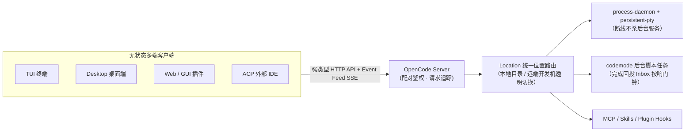

> [!FOCUS] 架构定位
> OpenCode 从 v2 起将 **Server（控制与执行服务）** 与 **Client（展示界面）** 彻底拆开，不仅让 TUI、桌面端、Web 端共用同一套强类型契约，还把长驻终端、后台代码执行和生态扩展做成了清晰的可插拔模块。

---

## 1. Client / Server 分离与多端接入

- **一套类型化 HTTP API + Event Feed**：`packages/server` 对外提供统一的 REST API（带代码生成的强类型 SDK）和实时事件流（Event Feed），并支持配对鉴权（Pairing）与请求追踪；
- **统一 Location（位置）模型**：把“本地目录”与“远端开发机”抽象为统一的 `Location` 服务映射，上层会话和文件操作按 Location 透明路由，使本地桌面 App 可以无缝操控远端机器上的 OpenCode Server；
- **原生支持 ACP 桥接**：CLI 内置 ACP 适配层，可直接被支持 [ACP 协议](#/agent-protocols/acp-and-a2a) 的外部 IDE 或多 Agent 宿主（如 Zed 等）作为标准 Coding Agent 挂载。

---

## 2. 独立进程守护、持久化 PTY 与 Code Mode

为了避免终端退出就把正在跑的构建/服务杀掉，以及减少频繁来回调用 LLM 的开销，OpenCode 拆出了三块独立基建：

1. **`process-daemon` 与 `persistent-pty`**：把长生命周期子进程与伪终端（PTY）托管在独立进程守护中，支持终端交互式命令、断线重连和可控关停超时（`shutdown-deadline`）；
2. **`codemode`（后台代码执行任务）**：允许模型编写脚本编排多步操作并交由后台 Job 异步执行，完成后通过合成消息投递回 Session 收件箱并按响门铃唤醒主循环；
3. **内置文件索引与检索**：深度集成 `ripgrep` 与本地全文检索索引（`session/search-index`），兼顾代码搜索与历史对话检索。

---

## 3. 生态扩展边界（MCP · Skills · Plugins）

- **MCP（Model Context Protocol）**：原生接入外部工具与数据源，统一纳入权限引擎管控（协议机制与安全治理详见 [Agent 互操作协议：MCP 架构演进](#/agent-protocols/mcp-architecture)）；
- **Skills 与目录级指令发现**：支持可复用的技能包与自动向上扫描项目 `AGENTS.md` 工程规范；
- **双层插件体系**：既有核心侧的 **Plugin Hooks**（可介入权限判定、会话压缩等生命周期），也有面向前端的 **GUI Plugins**（扩展桌面/Web 界面能力）。
