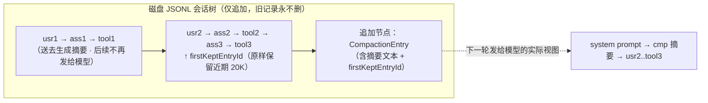

> [!FOCUS] 设计哲学
> Pi 的执行循环与压缩机制延续了“极致透明、非破坏追加”的思路：**任何压缩都不删除原始历史条目**，而是往会话树里追加一个带保留边界指针的 `CompactionEntry`；下一次请求时按边界动态拼装上下文。

---

## 1. 极简 Agent Loop 与插话队列边界

Pi 的主循环刻意保持极简、无隐藏魔法：
1. 新消息写入活跃分支 → 从活跃分支投影出模型兼容消息 + 系统提示词 + 工具定义 + 技能简介（完整技能正文按需加载）；
2. 模型流式输出文本与工具调用 → 落盘并执行工具 → 记录工具结果（完成一个 Turn）；
3. **插话（Steering）与追问（Follow-up）边界清晰**：
   - **Steering 消息**在当前助手 Turn 结束后进入，直接影响下一轮决策；
   - **Follow-up 消息**等 Agent 彻底干完当前手头工作后才进入；
   - **中止（Abort）**立刻停掉当前运行，并把还没发出去的排队消息退回编辑器，不丢用户输入。

---

## 2. 追加式上下文压缩（Append-Only Compaction）

### 2.1 触发时机与非破坏结构
- **自动触发公式**：`contextTokens > contextWindow - reserveTokens`（默认预留 **16,384 tokens**），在多轮工具完成后的 `prepareNextTurn` 阶段检查（若当前工具批次刚好终结整轮且无排队消息，则跳过无意义的压缩）；同时支持 `/compact [聚焦指令]` 手动触发，以及溢出 / `length` 截断后的一次性压缩重试；
- **倒推确定保留边界（`firstKeptEntryId`）**：从最新记录往前累加 token，凑够 **`keepRecentTokens`（默认 20K）** 找到切分点，把更早历史送给模型生成结构化摘要，最后在树尾追加一条 `CompactionEntry`（旧记录永不删除）：

### 2.2 三个极其细腻的工程细节
1. **超长单轮切分（Split User-Message Span）**：
   - 正常情况下切分点落在用户消息边界；但如果**单条用户指令触发了一连串长达几十轮的工具循环**，自己就超过了 20K 保留预算，切分点会落在中间某条 Assistant 消息上（**硬铁律：绝不从 `toolResult` 中间切开**，必须和对应 `toolCall` 绑定）；
   - 此时 Pi 会分别生成「更早历史摘要」和「当前超长单轮前半段摘要」，再合并成一份连贯交接总结。
2. **多次迭代压缩不丢“上一次保留的消息”**：
   - 第二次触发压缩时，摘要起点从**上一次压缩的 `firstKeptEntryId`** 开始（而不是从 `cmp` 节点之后开始），并把上一份摘要作为迭代上下文传入，确保上次幸存下来的消息这次也会被纳入总结，不出现记忆断层。
3. **摘要请求主动关闭 Prompt Cache 写入**：
   - 一次性压缩提示词几乎不会被后续请求复用，关闭缓存写可避免白白支付高昂的 Cache Write 费用（对比 [Anthropic Messages 缓存计费机制](#/llm-protocols/anthropic-messages)）。

---

## 3. 四大主流 Agent 压缩路线速览

| Agent | 压缩核心机制 | 独特工程亮点 |
|---|---|---|
| **[Codex](#/codex/core/compaction)** | 远端压缩 V2 + 本地摘要 + 预算开新窗 | **后台投机预压秒装** + 压缩时全量重算最新 `WorldState` |
| **[OpenClaw](#/openclaw/agent-loop/compaction)** | Session Pruning + 四段配额采样 + Safeguard | **压缩前 Memory Flush 护记忆** + 质量审计 + 超时确定性裁剪 |
| **[OpenCode](#/opencode/loop-and-compaction)** | 后台预计算 + 四级渐进降采样 + 阶梯缩容 | 15% 缓存吸收带 + `85%→35%` 溢出阶梯重试 |
| **Pi** | 追加式 `CompactionEntry` + `firstKeptEntryId` | **树形非破坏存储** + **超长单轮切分合并** + **切分支自动摘要** |
