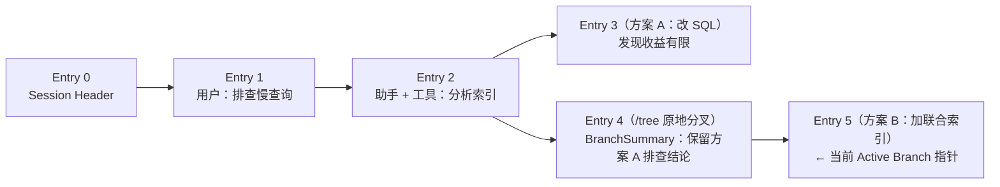

> [!FOCUS] Pi 最具辨识度的架构设计
> 大多数 Agent 把会话存成一根线性数组（`messages[]`）；一旦走错方向，要么硬着头皮继续聊污染上下文，要么重开会话丢掉前面铺垫。**Pi 把整个会话建模成一棵持久化在单个 JSONL 文件里的树**，让“回溯、分叉、丢弃死胡同但带走结论”变成一等体验。

## 1. 单文件树形 JSONL 模型

每条记录（用户消息、助手回复、工具调用、模型切换、压缩摘要）都是 JSONL 文件里的一行，带有唯一 **`id`** 和 **`parentId`**：

- **Active Branch（活跃分支）**：从根节点走到当前指针的一条唯一路径——**只有活跃分支会被转换成模型历史发给 LLM**，同一文件里的其他分支静静躺在磁盘上，既不消耗 token，也不会被覆盖丢失。
- **工作目录强绑定**：每个会话永久记住创建时的工作目录（`cwd`），恢复会话时自动回到原目录解析 `@path` 与项目配置；若原目录被重命名或删除，提供继续/分叉到当前目录的安全选项。

---

## 2. 三种分叉方式与「分支摘要（Branch Summarization）」

Pi 清晰区分了三种日常分叉意图：

| 命令 | 底层动作 | 适用场景 |
|---|---|---|
| **`/tree`** | 在**同一个 JSONL 文件内**移动指针、从历史任意节点长出新分支 | 探索同一任务的不同解法，相关尝试归档在一起 |
| **`/fork`** | 从某条历史用户消息切出，**复制生成独立的新会话文件** | 衍生出完全独立的新任务，后续互不干扰 |
| **`/clone`** | 把当前活跃分支完整拷贝成一个新会话 | 想在当前状态上留一个独立副本做对照实验 |

### 杀手级体验：切换分支时自动生成 Branch Summary
当你在方案 A 里折腾了十几轮、查清了 3 个根因但发现方案 A 走不通，用 `/tree` 退回到分叉点改走方案 B 时：
- 如果直接切过去，刚才查清的 3 个根因就白费了；
- Pi 允许你在离开旧分支时**自动对废弃路径做一次结构化总结（`BranchSummaryEntry`）**并挂在新分支起点——**既扔掉了方案 A 的全部垃圾试错日志，又把有效发现和文件修改记录无缝带进了方案 B**。
